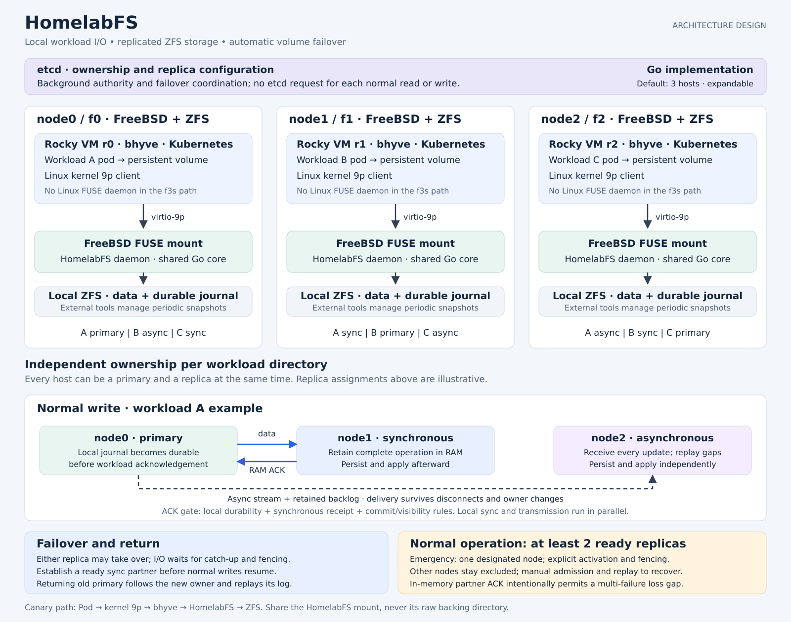

# HomelabFS architecture

**Live PoC:** stock Rocky 9 lacks 9p support and the matching-source module build failed. A one-time boot of ELRepo kernel-lt enabled 9p; basic I/O and SQLite WAL passed with cache=mmap. The combined 9p/FUSE path also passes initial functional checks; see [FUSE and benchmark results](PoC-fuse-and-benchmarks.md). See [f3 / Rocky PoC findings](PoC-f3-rocky.md).

HomelabFS is a distributed filesystem for the f3s homelab, primarily on FreeBSD. Its current purpose is to implement and validate local file access, replication and automatic failover using disposable lab and canary volumes. Production workload migration and NFS retirement belong to a separate future project. The default cluster has three nodes, each providing local ZFS storage and running workloads. Additional nodes can be admitted, including a fourth node. This is an initial design, not an implemented or proven protocol.

See [Motivation and goals](Motivation-and-goals.md) for the problem HomelabFS aims to solve.

## Agreed direction

- Implement HomelabFS in Go, with a shared core and explicit FreeBSD/Linux platform adapters.

- Validate HomelabFS with isolated canary volumes. Its test data path has no NFS dependency; virtio-9p provides host-to-guest file access. Existing production NFS, consumers and PVs remain in place.
- For a given data set, normal workload reads and writes occur together on one active node. On failure, both move to a replacement owner. Different data sets can be active on different nodes.
- Support both FreeBSD and Linux FUSE from the start, using two platform adapters around shared filesystem and replication code.
- For f3s, expose the FreeBSD HomelabFS mount to each colocated Rocky bhyve guest through virtio-9p. Rocky uses its kernel 9p client; no HomelabFS Linux FUSE daemon is deployed in this path.
- Files and directories support traditional Unix user/group ownership and permission bits.
- Normal file access must support the f3s application portfolio with POSIX-style semantics. Compatibility is a requirement to validate, not a current certification.
- Use ZFS-backed passthrough operations where possible, with HomelabFS coordinating mutations and read freshness. Reads wait when the required change has not yet been applied locally.
- With three healthy nodes, every mutation is sent to the local replica, a synchronous partner, and an asynchronous partner. Every acknowledged normal-mode mutation must be recoverable on the synchronous partner, including the complete ordered prefix it depends on; an in-memory copy is sufficient for the partner ACK.
- Async delivery is mandatory and retryable, including metadata operations. Offline replicas retain catch-up obligations; asynchronous means outside the client acknowledgement path, not best-effort delivery.
- A returning former owner follows the current owner and catches up before serving any workload I/O. It does not automatically reclaim ownership.
- Periodic ZFS snapshots are required as an additional recovery layer. Scheduling, retention, and snapshot administration are managed by external FreeBSD-level tools, not HomelabFS.
- Normal f3s operation with HomelabFS requires at least two mutually reachable, usable storage nodes. Each successful normal-mode write requires a durable local journal entry and a synchronous partner's in-memory acknowledgement. There is no automatic single-node write mode. Explicit emergency mode is the controlled exception.
- Local persistence and transmission to the synchronous partner run in parallel.
- The synchronous partner may acknowledge receipt in memory and persist afterward. This is an intentional durability tradeoff.
- A replication log lets a node recover changes missed while offline.
- Concurrent writers on different nodes must not create conflicting file versions.
- Require an explicit admitted-node list. WireGuard membership alone grants no HomelabFS access; volume roles and emergency restrictions are authorized separately.
- Explicit emergency mode designates one serving node, permits durable local-only writes, and rejects automatic rejoining. Recovery requires manual peer admission, journal catch-up, and explicit restoration of normal replication.
- Coordination must stay off the steady-state read/write path. etcd was selected earlier; the revised recommendation retains it only for infrequent ownership and configuration changes, subject to the user's latency requirement. HomelabFS enforces ownership and maintains replication progress directly.

## Architecture diagram

[Open the SVG diagram](HomelabFS-architecture.svg).

## Design documents

| Document | Contents |
|---|---|
| [Cluster and ownership](Cluster-and-ownership.md) | Node admission, per-volume roles, ownership, and etcd |
| [Replication](Replication.md) | Write path, journals, catch-up, and failover continuity |
| [Normal replication protocol](spec/Replication-protocol.md) | Fixed-owner sessions, messages, commit/visibility gates and recovery evidence; unimplemented |
| [Journal storage](Journal-storage.md) | Dataset layout, checkpoints, retention, and safe cleanup |
| [Performance](Performance.md) | Bounded concurrency, connection pools, fairness, and measurement |
| [Recovery](Recovery.md) | Automatic recovery, failures, fencing, and manual escalation |
| [Takeover state machine](spec/Takeover.md) | Closure recovery, durable promises, serving gates and approved native VM-only fence policy; implementation and validation pending |
| [Emergency mode](Emergency-mode.md) | Single-node activation, exclusion, manual rejoin, and exit |
| [Kubernetes canaries](Kubernetes-and-migration.md) | Canary PV publication, pod relocation, guest access and future scope |
| [Filesystem semantics](Filesystem-semantics.md) | POSIX-style behavior, permissions, and f3s applications |
| [Platform interfaces](Platform-interfaces.md) | Shared core, two FUSE adapters, and bhyve virtio-9p |
| [Security](Security.md) | Proposed WireGuard transport, node identity, authorization, and encryption |
| [Snapshots and restore](Snapshots-and-restore.md) | External ZFS snapshots and coordinated restore |
| [Integration tests](Integration-tests.md) | 36 native FreeBSD scenario families, assertions, and rollout gates |

Diagrams live with the topics they illustrate: placement in Cluster and ownership; writes and failover in Replication; emergency recovery in Emergency mode; platform and guest paths in Platform interfaces.

## Decisions to make next

1. Use the [five representative synthetic canary patterns](Canary-patterns.md) and [volume and namespace policy](spec/Volumes.md). Paul selected per-volume mounts and cross-volume transaction design before implementation; an explicit transaction API preserves that topology. Ordinary cross-mount rename/link still returns EXDEV. The transaction protocol must be specified before freezing affected API/journal/service implementation. Budget the canary footprint and operational isolation in [Deployment readiness](Deployment-readiness.md); a full production migration inventory is outside this project.
2. Implement the [durability and read-freshness contract](spec/Durability.md): Paul confirmed local durable journal plus partner memory receipt for ordinary daemon writes and fsync on 2026-10-28; two-durable-copy fsync is outside initial scope. Commit/recovery protocol details and actual adapter/9p validation remain open.
3. Implement, model and validate the approved isolated fence policy in [takeover, fencing and recovery](spec/Takeover.md), including recovery of acknowledged operations. Policy approval alone authorizes no installation or disruptive VM operation.
4. Specify emergency activation/fencing, manual admission and exit, retention limits, and safe group reconfiguration when adding nodes. Implement the failure policies above without automatic acknowledgement downgrades.
5. Use [go-fuse v2.9.0 for the initial adapters](adr/0001-fuse-library.md), selected from source review and Linux/native PoC evidence. Complete the remaining native capability gates and validate the real daemon through bhyve virtio-9p and f3s application semantics.

Suggested development order: validate the selected guest transport and both FUSE frontends; specify and exercise the commit/fencing state machine; local filesystem and journal replay; replication with fixed ownership; bounded queues and restart recovery; then automatic ownership transfer with partition/crash tests and Kubernetes integration. Follow the [integration-test matrix and rollout gates](Integration-tests.md#integration-test-matrix) before accepting canary results. No production workload migration is planned here.

## Packaging and validation

Distribute validated kernel/module RPMs through `pkgrepo.f3s.buetow.org`, building once per supported target and reusing the same artifacts across nodes. See [Packaging and rollout](Packaging-and-rollout.md) and the [PoC runbook](PoC-runbook.md). This is planned distribution, not a completed cluster rollout.

## Two-stage validation

Every run requires explicit user approval; scripts handle execution, evidence, and cleanup without an LLM control loop. See [Test automation](Test-automation.md).

1. [Native integration](Integration-tests.md): provision three disposable FreeBSD bhyve VMs, install HomelabFS, and test direct FUSE access with fault injection. Initial placement is three 2 GiB VMs on f3, subject to memory admission and an approved temporary clean shutdown/restoration of its existing Rocky VM. Pausing Rocky does not free its RAM. [Lab lifecycle](FreeBSD-test-lab.md).
2. After separately authorized deployment to real f3s hosts, [live smoke tests](Live-smoke-tests.md): exercise the actual guest-to-host path from the Rocky VMs using dedicated test volumes and bounded I/O. No routine destructive production fault injection.

9p and Kubernetes lifecycle tests are tracked separately in [Deployment compatibility](Deployment-tests.md); they are not dependencies of the native FreeBSD integration harness.

## Enforced planning and implementation gates

Read [Deployment readiness](Deployment-readiness.md) before freezing the volume,
fencing or deployment design. Representative test patterns feed volume policy; bounded canary
capacity feeds fixture mapping and acceptance profiles. Guest/host fencing is chosen in
the takeover spec, not postponed to CSI. Fixed-owner replication implementation
waits for both the commit model check and the real-daemon guest compatibility
gate. This is development ordering, not permission to add 9p to native Stage 1.
Rollout planning may happen before test execution finishes; publication,
canary deployment and test exercises retain their own prerequisites and explicit
approvals. Disruptive exercises use isolated test infrastructure; production
migration and NFS retirement have no execution tasks in this project.
