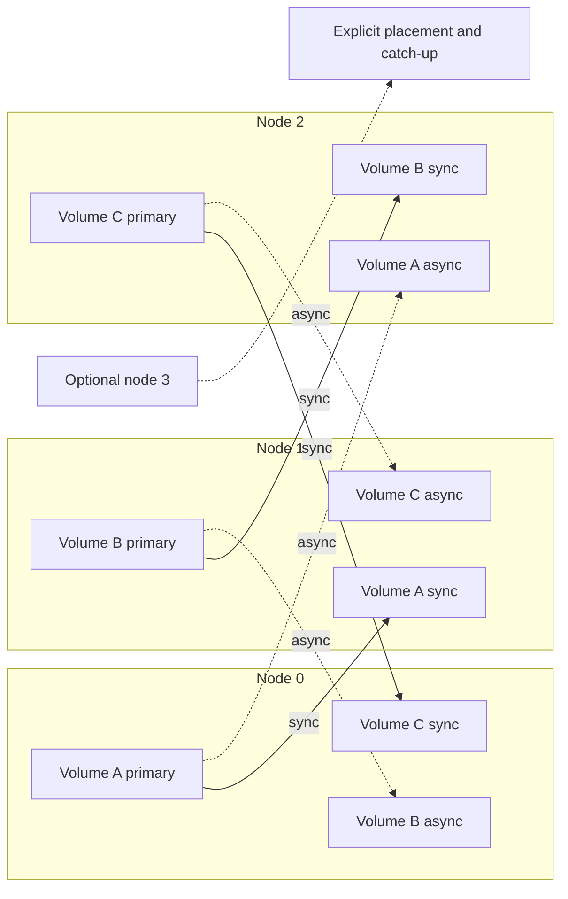

# HomelabFS cluster and ownership

[Architecture overview](Architecture.md)

Cluster membership, per-volume placement, and coordination authority.

## Cluster size and replica placement

Three nodes is the default deployment, not a hard cluster-size limit. Support explicit admission of additional nodes. Recommended default replication factor remains three per workload directory: one primary, one synchronous replica, and one asynchronous replica on distinct physical hosts. A fourth node adds placement and workload capacity; it does not automatically become a fourth replica of every directory. Changing replication factor is a separate future configuration decision.

Track cluster membership separately from each volume's replica membership. Newly admitted nodes begin with no authority to serve existing volumes. To place a replica there, copy a consistent checkpoint and journal suffix, verify readiness, then activate a fenced group configuration. Do not automatically rebalance existing owners merely because a node joins; use planned transfers and preserve workload locality.

The earlier two-of-three reasoning applies to a volume's replica group. For membership changes, use a proven joint/overlapping configuration transition that preserves acknowledged history and fencing; two acknowledgements from arbitrary cluster members are not sufficient. A fourth empty node cannot substitute for an up-to-date partner until it has recovered the required state.

Keep coordination membership independent too: adding a fourth storage node need not add a fourth etcd voter. The recommended initial coordination deployment remains three members; any later quorum changes require their own managed transition.

## Proposed node layout

```text
Local workload
      |
HomelabFS mount (proposed: FreeBSD FUSE)
      |
HomelabFS daemon
      +-- ownership client -------------------- etcd
      +-- local journal and data -------------- local ZFS
      +-- synchronous replication ------------ partner daemon
      +-- asynchronous replication ----------- third daemon
```

Ownership is per independent workload directory, not per physical node or the whole filesystem. All cluster nodes can be primaries simultaneously for different workloads. Each workload has one active owner for reads and writes and two passive replicas; a node can be a primary for one directory and a replica for others.

Example placement (partner assignments are illustrative):

| Workload directory | Primary | Synchronous replica | Asynchronous replica |
|---|---|---|---|
| `/workloads/a` | node0 | node1 | node2 |
| `/workloads/b` | node1 | node2 | node0 |
| `/workloads/c` | node2 | node0 | node1 |

Each directory is an independent replication group with its own ownership epoch, ordered journal stream, commit/apply progress, replica checkpoints, and recovery state. Journal storage may be physically shared by a daemon, but ordering and recovery must remain identifiable per group. A lagging workload must not impose an unnecessary global replication barrier on unrelated workloads; shared disk, memory, and network limits still require resource management.

For example, if node0 fails, workload a can move to node1 while workload b stays on node1 and workload c stays on node2. Workload b loses its asynchronous replica; workload c loses its synchronous replica and must establish a replacement before acknowledging further writes. Each group therefore handles the same physical failure according to its own roles. Catch-up of returning node0 is also tracked separately for each directory.

The configured directory roots define group boundaries. Keep workload operations inside those roots; cross-group rename/hard-link semantics and management of the shared parent namespace still need an explicit policy. Do not infer support for atomic cross-group operations from local ZFS support. Concurrent read-sharing of the same directory is not the baseline.

## Independent workload placement

Partner choices are illustrative. A new node has no existing data-serving rights until placement and catch-up complete.



## Coordination without per-operation etcd access

Recommended architecture: long-lived exclusive ownership of both reads and writes, direct daemon replication, and daemon-held replication progress. Do not put file dirtiness, per-write sequence updates, or per-read checks in etcd. Background ownership maintenance and infrequent transfers may use etcd, but normal I/O must not perform an etcd transaction.

Retain etcd for ownership allocation and configuration changes unless measurements or operational constraints justify removing it. Removing etcd entirely does not remove the need for agreement during failover: HomelabFS would need an established embedded consensus implementation or an external fencing authority. Designing a new election protocol merely to save occasional coordination latency is not the recommended starting point. No latency measurements have been made yet.

Use increasing ownership epochs and configuration identifiers. In normal mode, persist fencing promises on the required replica-group quorum before activating a new configuration; replicas must reject older epochs thereafter, including after restart. Every acknowledged normal-mode write requires participation by two members of its configured three-replica group; this is not a majority of an arbitrarily sized cluster. Old and new write majorities intersect, allowing a properly serialized fencing transition to prevent two configurations from independently acknowledging writes. This argument requires an actual recovery protocol, not just counting acknowledgements: retain accepted operations at the intersecting node and reconcile them before enabling the new writer.

An etcd ownership grant authorizes starting takeover; it does not authorize serving I/O immediately. Lease expiry alone does not stop a paused old owner. Takeover must close out prior writes, fence old epochs, recover data, and revoke or safely expire old read permissions. Direct local reads and cached reads need fencing too, since they do not contact a write majority.

Suggested deployment if etcd is retained: a dedicated three-member cluster, one member per physical node, with data on independent local storage. Keep the k3s and HomelabFS coordination services independently bootstrappable. Conservatively stop affected serving rights when their authority cannot be renewed or established, and allow no ownership transfers without coordination quorum. Continuing established groups during an etcd outage would require a separately proven authority protocol and is not assumed here.

The safety rules above are design constraints, not a complete consensus or lease implementation. Specify and model-check the transition state machine before implementing automatic failover. Sources for the distinction between coordination and storage enforcement: [etcd API guarantees](https://etcd.io/docs/v3.6/learning/api_guarantees/), [etcd fencing example](https://github.com/etcd-io/etcd/blob/main/contrib/lock/README.md).

## Transport and authorization

See [Security.md](Security.md) for the proposed persistent replication connections over existing WireGuard links, explicit node admission, per-volume authorization, etcd service credentials, and emergency-mode exclusion. Authenticated membership does not itself grant volume ownership.

## FreeBSD and etcd

FreeBSD Ports provides a native etcd 3.6 port at `devel/etcd36`, with package name `coreos-etcd36`. Binary package availability depends on the configured repository and target system. FreeBSD is not listed as an upstream-supported etcd platform; validate operation on the actual nodes.

References: [FreeBSD etcd port](https://github.com/freebsd/freebsd-ports/blob/main/devel/etcd36/Makefile), [etcd supported platforms](https://etcd.io/docs/v3.6/op-guide/supported-platform/), [etcd API guarantees](https://etcd.io/docs/v3.5/learning/api_guarantees/), [etcd fencing example](https://github.com/etcd-io/etcd/blob/main/contrib/lock/README.md).

## Canary placement prerequisite

Use the [synthetic consumer/path fixtures and canary resource budget](Deployment-readiness.md).
Aliased claims and nested roots must not create conflicting owners. Test grouped
placement and its multi-volume constraints with disposable data. Do not alter
production workload scheduling or require a production migration map.
