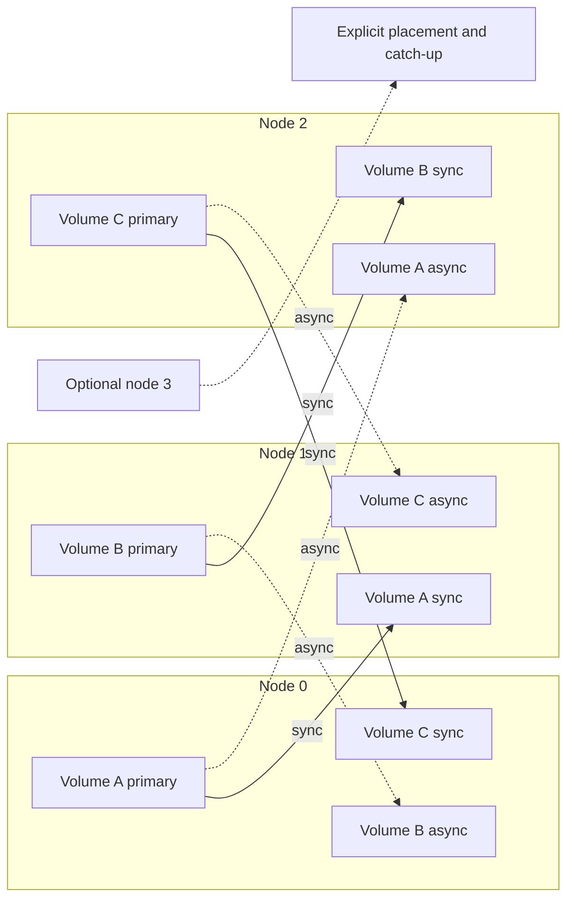

# HomelabFS cluster and ownership

[Architecture overview](Architecture.md)

Cluster membership, per-volume placement, and coordination authority.

## Cluster size and replica placement

Three nodes is the default deployment, not a hard cluster-size limit. Support explicit admission of additional nodes. Recommended default replication factor remains three per workload directory: one primary, one synchronous replica, and one asynchronous replica on distinct physical hosts. A fourth node adds placement and workload capacity; it does not automatically become a fourth replica of every directory. Changing replication factor is a separate future configuration decision.

Track cluster membership, write-origin admission and each volume's replica placement separately. In normal mode any admitted HomelabFS node may accept writes for any volume regardless of preferred ownership, subject to permissions, valid authority and the commit protocol. A node need not become the preferred owner to originate a write. Admission alone does not make an empty node an up-to-date replica or authorize stale reads. Replica placement requires a verified checkpoint/suffix and safe configuration transition. Adding a node does not automatically redistribute replica sets; periodic preferred-owner reconsolidation is a separate policy.

The all-origin normal boundary is not a two-of-three placement quorum: an
outside origin may supply the only durable new fragment while the owner retains
RAM. Keep the complete admitted-node set S and origin/grant lineage discoverable
across membership changes. Activation needs sealed source/choice reports or
equivalent verified complete durable coverage and issued-grant frontier proof,
plus positive exclusion of old origin/read-cache rights. Two arbitrary members,
or two placement replicas, cannot prove it. A fourth empty node cannot substitute
for recovered history. Joint/overlapping placement transitions remain a separate
unimplemented requirement and must preserve all outside-origin obligations.

Keep coordination membership independent too: adding a fourth storage node need not add a fourth etcd voter. The recommended initial coordination deployment remains three members; any later quorum changes require their own managed transition.

## Proposed node layout

```text
Local workload
      |
HomelabFS mount (proposed: FreeBSD FUSE)
      |
HomelabFS daemon
      +-- ownership client -------------------- etcd
      +-- local journal and data -------------- local ZFS
      +-- synchronous replication ------------ partner daemon
      +-- asynchronous replication ----------- third daemon
```

Preferred ownership is per volume, not per physical node or the whole filesystem. Any admitted node can originate writes for the same volume. The preferred owner retains the complete ordered committed memory view and may serve it before local disk persistence. The originating writer supplies local durable journal evidence; an owner-originated write instead requires a distinct synchronous partner's memory receipt. Replica placement, write origin and preferred ownership are distinct roles. The [normal contract](spec/Replication-protocol.md) selects one outstanding grant
per closure, origin-local durable choice/result and explicit owner selection and
publication. A remote origin needs O+A, without a third mandatory synchronous
host; an owner-origin operation needs A+B. This is unimplemented and unproven
pending `dz3`, not a fixed-owner two-of-three proof.

Example placement (partner assignments are illustrative):

| Workload directory | Primary | Synchronous replica | Asynchronous replica |
|---|---|---|---|
| `/workloads/a` | node0 | node1 | node2 |
| `/workloads/b` | node1 | node2 | node0 |
| `/workloads/c` | node2 | node0 | node1 |

Each directory is an independent replication group with its own ownership epoch, globally selected order mapped to exact origin journal streams, commit/apply progress, replica checkpoints, and recovery state. Journal storage may be physically shared by a daemon, but ordering and recovery must remain identifiable per group. A lagging workload must not impose an unnecessary global replication barrier on unrelated workloads; shared disk, memory, and network limits still require resource management.

For example, if node0 fails, workload a may move to node1 after complete
origin-source recovery and fencing while unrelated closures retain their own
owners. For an unchanged owner, loss of B stops owner-origin completions until a
safe partner transition; remote O+A completions need no B if all their dependencies
and authority remain ready. A replica's failure can also remove a required durable
origin source, independent of placement role. Catch-up remains per directory.

The configured directory roots define group boundaries. Keep workload operations inside those roots; cross-group rename/hard-link semantics and management of the shared parent namespace still need an explicit policy. Do not infer support for atomic cross-group operations from local ZFS support. Concurrent access from different admitted hosts is a requirement; its read coherence and commit rules must be validated.

## Independent workload placement

Partner choices are illustrative. A new node has no existing data-serving rights until placement and catch-up complete.



## Periodic ownership reconsolidation

Decision recorded on 2026-10-30: periodically prefer the FreeBSD HomelabFS host
receiving the most requests for a volume. Rocky Kubernetes pods may move between
workers; requests reach the colocated FreeBSD daemon through 9p and FUSE.
Ownership need not move immediately because non-owners may still accept reads
and writes. This policy does not change the selected 9p deployment path.

Measure original admitted frontend requests by volume and originating host over
a bounded window. Exclude replication traffic, owner memory-copy receipts and
retry duplication. Guest cache hits are not visible to the daemon, so these
counts do not claim to count every application syscall. Choose the evaluation
interval, window, meaningful demand advantage, minimum tenure and cooldown in
the reviewed policy before implementation; no numeric defaults are selected here.
Use fresh statistics and require destination eligibility, capacity and readiness.
Avoid transfers for brief demand spikes or stale measurements.

Use etcd to coordinate the transfer intent and configuration/term changes, with
HomelabFS enforcing ordered handoff and fencing. An etcd lease or CAS alone is
not a data or cache fence. Keep request counters local and publish summaries
periodically rather than introducing a per-request etcd transaction.

A handoff must preserve the complete committed memory view, ordered dependencies,
in-flight operations, uncertain results and retry identities before the new
owner serves. Read readiness may precede persistence to the new owner's own
disk. Still-admitted origins retain their ability to accept reads and writes;
coordinate or briefly gate affected operations when safety requires it. A routine
placement change does not inherently require stopping the old owner's VM or
revoking every writer. Preserve transaction affinity, aliased object homes and
closure-wide ordering when selecting the transfer unit.

Distinguish this planned handoff from crash takeover/fencing and from replica-set
reconfiguration. Emergency single-survivor mode remains an explicitly authorized
exception. This is the agreed target, not implemented or validated behavior. The normal
contract defines source/choice preservation constraints; detailed policy and
cooperative handoff remain `kz3`. Old owner-only models/tests remain scoped v1
history and do not establish a handoff proof.

## Coordination without per-operation etcd access

Target architecture: coordinated multi-origin reads and writes, one preferred owner for locality and the committed memory view, direct daemon replication, and daemon-held replication progress. Do not put file dirtiness, per-write sequence updates, or per-read checks in etcd. Background ownership maintenance and infrequent transfers may use etcd, but normal I/O must not perform an etcd transaction.

Retain etcd for ownership allocation and configuration changes unless measurements or operational constraints justify removing it. Removing etcd entirely does not remove the need for agreement during failover: HomelabFS would need an established embedded consensus implementation or an external fencing authority. Designing a new election protocol merely to save occasional coordination latency is not the recommended starting point. No latency measurements have been made yet.

Use increasing ownership epochs/configuration identifiers and durable transition
promises. The [normal protocol](spec/Replication-protocol.md#outside-origins-recovery-and-authority-transitions)
requires complete old admitted-origin grant/choice/source coverage and positive
fencing before a successor activates. Old fixed three-replica majority
intersection does not establish this when origins lie outside placement. The
complete report survey can be replaced only by equivalent verified durable
coverage and complete issued-grant frontier evidence. Unknown evidence gates
activation; a node with fully proven replacement obligations may be retired
without reading a permanently dead disk.

An etcd allocation authorizes starting a transition, never serving. Old granted
origins, owner-origin memory partners, readers and cache domains must be positively
closed/fenced, including descriptors and mmap. Lease expiry alone does not stop
a paused daemon or cached reads. Preserve complete accepted/selected RAM and
origin journals before voluntary stop, and recover dependencies before opening
any successor gate. No steady-state operation consults etcd.

Suggested deployment if etcd is retained: a dedicated three-member cluster, one member per physical node, with data on independent local storage. Keep the k3s and HomelabFS coordination services independently bootstrappable. Conservatively stop affected serving rights when their authority cannot be renewed or established, and allow no ownership transfers without coordination quorum. Continuing established groups during an etcd outage would require a separately proven authority protocol and is not assumed here.

The safety rules above are design constraints, not a complete consensus or lease implementation. Specify and model-check the transition state machine before implementing automatic failover. Sources for the distinction between coordination and storage enforcement: [etcd API guarantees](https://etcd.io/docs/v3.6/learning/api_guarantees/), [etcd fencing example](https://github.com/etcd-io/etcd/blob/main/contrib/lock/README.md).

The v1 [takeover specification](spec/Takeover.md) retains explicit positive
cache fencing without a clock-based serving-expiry assumption and fixed-owner
recovery mechanics. It is not sufficient for the new all-origin source survey;
`gz3` must revise the detailed recovery state machine. Paul approved its narrow native VM-only fence
policy; implementation and validation remain pending. Neither policy approval
nor etcd allocation grants serving authority.

## Transport and authorization

See [Security.md](Security.md) for the proposed persistent replication connections over existing WireGuard links, explicit node admission, per-volume authorization, etcd service credentials, and emergency-mode exclusion. Authenticated membership does not itself grant volume ownership.

## FreeBSD and etcd

FreeBSD Ports provides a native etcd 3.6 port at `devel/etcd36`, with package name `coreos-etcd36`. Binary package availability depends on the configured repository and target system. FreeBSD is not listed as an upstream-supported etcd platform; validate operation on the actual nodes.

References: [FreeBSD etcd port](https://github.com/freebsd/freebsd-ports/blob/main/devel/etcd36/Makefile), [etcd supported platforms](https://etcd.io/docs/v3.6/op-guide/supported-platform/), [etcd API guarantees](https://etcd.io/docs/v3.5/learning/api_guarantees/), [etcd fencing example](https://github.com/etcd-io/etcd/blob/main/contrib/lock/README.md).

## Canary placement prerequisite

Use the [synthetic consumer/path fixtures and canary resource budget](Deployment-readiness.md).
Aliased claims and nested roots must not create conflicting owners. Test grouped
placement and its multi-volume constraints with disposable data. Do not alter
production workload scheduling or require a production migration map.
