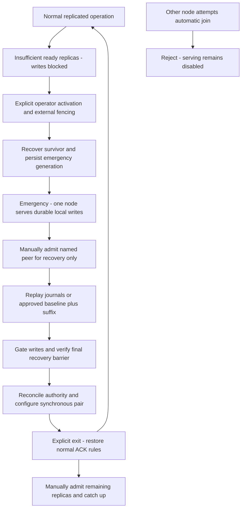

# HomelabFS emergency mode

[Architecture overview](Architecture.md)

A deliberately activated exception to normal replication: one node serves recovered volumes while all other nodes remain excluded until manual admission.

The [emergency protocol specification](spec/Emergency.md) defines the plan-bound
operator interface, independent durable authority, approved native VM-only fence,
restart/admission rules, final durable pair barrier and retention policy. Its
mandatory emergency format upgrade and controller remain unimplemented; the
existing normal journal format cannot encode local-only protection. Policy/design
approval authorizes no actual activation, loss selection or disruptive window.

## Recovering normal all-origin history

Emergency activation does not convert missing history into local truth. Before
non-loss activation, inventory every old admitted origin S and used sequencer/
partner ledger, including outside placement R. Obtain sealed close reports or
positive exclusion plus verified complete durable equivalents and the complete
issued-grant frontier. A remote W may hold the only durable fragment while A
served its committed view in RAM; the survivor's applied tree cannot substitute.
Unknown slots/results/dependencies block that closure. Adopt exact durable COMMITs
with unknown selection/result; NO_EFFECT requires durable DECLINE or complete
closed absence proof. An emergency flag never supplies a transaction ABORT.

If A RAM and W's unique disk are actually lost without replacement, explicitly
report the accepted normal durability gap. Separate user-authorized whole-closure
loss recovery must preserve old copies and reject uncertain old IDs permanently
or establish a proved disjoint identity namespace; a new generation is insufficient.
Durably collect the complete chosen graph, claims/results, homes/transaction and
snapshot/offline obligations on the survivor before local-only serving. Retain
all original source pins until verified durable replacements and protected release.

Exit durably establishes the full all-origin and emergency graph on prospective A
and distinct B and closes all old reader/origin/cache rights before restoring
normal authority. Normal writes then use actual origin durability: remote W+A,
owner-origin A+B RAM; no extra third synchronous host. Every still-admitted origin
can write every volume. Explicit exclusions survive exit until manual admission.
The synced local daemon's `Gen0` is an independent local mode, never a normal
ServingGrant or an implemented emergency workflow. See the
[detailed composition contract](spec/Emergency.md#all-origin-normal-history-composition-gz3).

## Explicit single-node emergency mode

Emergency mode is a cluster-wide administrative recovery state with one designated serving node. That node may serve reads and writes for volumes it has recovered; other nodes must keep their HomelabFS serving mounts and automatic workload-volume activation disabled. This is not an automatic response to losing quorum and does not imply that Kubernetes itself can operate with only one surviving control-plane node.

Activation requirements:

1. Choose the survivor and explicitly fence every excluded node from storage serving, including any old primary and its guest access path. Power fencing, isolation of workload access, or verified shutdown may be needed. A record on the survivor alone cannot stop a partitioned old cluster. Do not rely on an etcd quorum that is unavailable.
2. Inspect the complete all-origin source/dependency inventory and recover each usable closure. The chosen survivor may be stale; never claim it contains writes held only by unreachable replicas. Require an explicit decision before accepting known or uncertain data loss, and preserve old copies.
3. Persist an emergency recovery generation, designated node identity, admission policy, and mode on independent local storage. The generation invalidates prior authority when peers are later admitted. Startup must honor this state; restart must not silently exit emergency mode.
4. Enable the survivor's recovered volumes. Acknowledged mutations require its durable local journal, with no partner ACK. Retain the complete emergency journal needed for recovery; local snapshots/backups remain external.

No peer may automatically join, regain ownership, or enable its mounts. The designated node rejects normal admission and replication requests from unapproved members, and external fencing keeps excluded nodes from independently resuming their old configuration. Disaster recovery must cover both controls, including stale etcd members that might otherwise form an old quorum.

Manual recovery and exit:

1. Admit one named peer with recovery-only permission while keeping its workload-serving mounts off. This permission allows its daemon to receive data, not serve reads or writes.
2. Check identity and history. Preserve/quarantine divergent suffixes, then transfer/replay the complete selected source graph and exact results in order, including emergency writes and outside-origin dependencies. If journals are unavailable or history diverges, use an explicitly selected consistent snapshot baseline and replay its suffix; never silently skip a gap.
3. Continue streaming while the emergency primary runs. At transition, briefly gate new mutations, establish the final recovery barrier, and verify the peer durably holds the complete selected graph, closed frontier and dependencies. If multiple volumes are involved, ensure every volume being returned to service has a ready partner.
4. Reconcile or rebuild coordination authority from the new recovery generation; never blindly merge a stale etcd cluster. Persist the new group configurations and serving authority, explicitly exit emergency mode, and restore the normal origin-durable plus designated distinct-memory and view-barrier requirements before releasing gated writes.
5. Manually admit remaining peers, replay their backlog, and enable their configured roles only when ready. A ready A/B pair permits normal activation only with complete all-origin recovery coverage; remaining placement replicas retain their async catch-up obligations. The former primary does not automatically reclaim ownership.

Do not trim emergency history needed by excluded peers without a recoverable checkpoint/retention plan. If literal journal replay is required and capacity runs out, archive history or stop writes. Losing the emergency survivor can lose all changes absent from external backups; there is no second-copy guarantee in this mode.

## Emergency mode and manual rejoin

