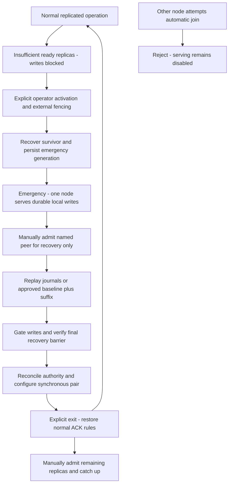

# HomelabFS emergency mode

[Architecture overview](Architecture.md)

A deliberately activated exception to normal replication: one node serves recovered volumes while all other nodes remain excluded until manual admission.

The [emergency protocol specification](spec/Emergency.md) defines the plan-bound
operator interface, independent durable authority, approved native VM-only fence,
restart/admission rules, final durable pair barrier and retention policy. Its
mandatory emergency format upgrade and controller remain unimplemented; the
existing normal journal format cannot encode local-only protection. Policy/design
approval authorizes no actual activation, loss selection or disruptive window.

## Explicit single-node emergency mode

Emergency mode is a cluster-wide administrative recovery state with one designated serving node. That node may serve reads and writes for volumes it has recovered; other nodes must keep their HomelabFS serving mounts and automatic workload-volume activation disabled. This is not an automatic response to losing quorum and does not imply that Kubernetes itself can operate with only one surviving control-plane node.

Activation requirements:

1. Choose the survivor and explicitly fence every excluded node from storage serving, including any old primary and its guest access path. Power fencing, isolation of workload access, or verified shutdown may be needed. A record on the survivor alone cannot stop a partitioned old cluster. Do not rely on an etcd quorum that is unavailable.
2. Inspect available journals and recover each usable volume. The chosen survivor may be stale; never claim it contains writes held only by unreachable replicas. Require an explicit decision before accepting known or uncertain data loss, and preserve old copies.
3. Persist an emergency recovery generation, designated node identity, admission policy, and mode on independent local storage. The generation invalidates prior authority when peers are later admitted. Startup must honor this state; restart must not silently exit emergency mode.
4. Enable the survivor's recovered volumes. Acknowledged mutations require its durable local journal, with no partner ACK. Retain the complete emergency journal needed for recovery; local snapshots/backups remain external.

No peer may automatically join, regain ownership, or enable its mounts. The designated node rejects normal admission and replication requests from unapproved members, and external fencing keeps excluded nodes from independently resuming their old configuration. Disaster recovery must cover both controls, including stale etcd members that might otherwise form an old quorum.

Manual recovery and exit:

1. Admit one named peer with recovery-only permission while keeping its workload-serving mounts off. This permission allows its daemon to receive data, not serve reads or writes.
2. Check identity and history. Preserve/quarantine divergent suffixes, then replay missing journals from the emergency primary in order, including emergency writes. If journals are unavailable or history diverges, use an explicitly selected consistent snapshot baseline and replay its suffix; never silently skip a gap.
3. Continue streaming while the emergency primary runs. At transition, briefly gate new mutations, establish the final recovery barrier, and verify the peer has the required prefix. If multiple volumes are involved, ensure every volume being returned to service has a ready partner.
4. Reconcile or rebuild coordination authority from the new recovery generation; never blindly merge a stale etcd cluster. Persist the new group configurations and serving authority, explicitly exit emergency mode, and restore the normal synchronous ACK requirement before releasing gated writes.
5. Manually admit remaining peers, replay their backlog, and enable their configured roles only when ready. Restoring two ready replicas permits degraded normal operation; adding the third restores asynchronous redundancy. The former primary does not automatically reclaim ownership.

Do not trim emergency history needed by excluded peers without a recoverable checkpoint/retention plan. If literal journal replay is required and capacity runs out, archive history or stop writes. Losing the emergency survivor can lose all changes absent from external backups; there is no second-copy guarantee in this mode.

## Emergency mode and manual rejoin

