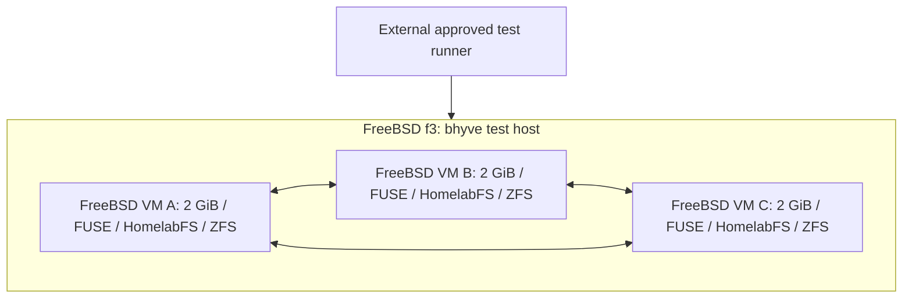

# Disposable FreeBSD integration lab

[Stage 1 test matrix](Integration-tests.md) · [Approval and automation](Test-automation.md) · [Stage 2 live smoke tests](Live-smoke-tests.md)

## Preparation status

Three stopped FreeBSD guests were prepared on f3 on 2026-10-25. See [inventory and reproduction instructions](FreeBSD-lab-preparation.md). They have never been booted; HomelabFS installation and test execution remain pending.

## Initial layout

Run three temporary FreeBSD bhyve VMs on existing f3s hardware. The first proposed layout is all three on f3, each with **2 GiB RAM**, for 6 GiB of guest RAM in total. Each VM has its own FreeBSD kernel, disposable OS/data disks, guest ZFS pool, and installed HomelabFS daemon. Native test programs access HomelabFS FUSE mounts inside those VMs:

One private etcd member may run inside each VM, using local storage outside HomelabFS. Test workloads and daemon processes are native FreeBSD processes; there is no 9p, Rocky workload guest, Kubernetes, or nested bhyve dependency in Stage 1. Physical f3s hosts provide virtualization only. Test membership, identities, network segments, and datasets must never overlap production.

## Memory admission and Rocky maintenance

2 GiB per VM is an initial small-test target, not an established capacity requirement. Account for FreeBSD, ZFS ARC, HomelabFS buffers, etcd, native database clients, and hypervisor overhead. Bound guest caches and test concurrency through versioned test configuration; record those settings with results. Unintended OOM or swap pressure is an infrastructure failure, not automatically a replication defect. Large workload profiles and the fourth-node scenarios may need larger guests or another host.

Before approval, the runner inventories physical memory, existing VM allocations, host memory pressure, available disk space, and proposed guest budgets. It includes configurable host/overhead headroom in its admission calculation. A starting reservation of at least 4 GiB for the physical host and overhead can be evaluated, but passing the arithmetic alone is not enough: observed memory pressure can still reject the run. Do not assume ARC is instantly reclaimable or overcommit until the host swaps.

f3 was observed with approximately 16 GiB physical memory and its existing Rocky development VM configured for 12 GiB. Adding 6 GiB of test guests alongside that allocation is not an acceptable default. **Pausing Rocky normally retains its RAM; use a clean temporary shutdown to release it.** A proposed run may include stopping `rocky` only when that downtime is explicitly included in the approved plan. Record its initial state and restore it afterward; a VM that was already stopped must stay stopped. Do not alter its persistent autostart policy or delete its disks. Inspect its active users before the maintenance window.

If Rocky cannot be stopped or headroom is insufficient, reject that placement and prepare a new plan using other available f3s hosts or a smaller test profile. Do not silently change placement, reduce the three-node requirement, or stop other VMs. No existing VM is stopped by this planning document.

## Script-controlled lifecycle

Both approval and execution follow [the automation contract](Test-automation.md). A run uses a unique ID and an ownership manifest for every VM, disk, dataset, address, credential, and fault rule it creates.

1. **Plan:** resolve immutable FreeBSD image and HomelabFS artifact versions, package checksums, placement, RAM/CPU/disk limits, test selection, seeds, runtime limits, and any Rocky downtime. Show the operator the complete plan before execution.
2. **Approve:** require explicit approval for that exact plan. Prior approval of a different run, a CI event, or an LLM instruction cannot substitute.
3. **Provision:** revalidate admission; record original host/VM state; cleanly stop Rocky only if approved; clone clean test images; attach isolated disks/networking; boot the three FreeBSD VMs. Use unique machine identities, SSH host keys, and test-cluster credentials.
4. **Install and initialize:** install the same validated HomelabFS packages from pkgrepo or the pre-staged artifact cache. Initialize only run-owned ZFS pools/datasets, private coordination, and FUSE mounts. Confirm each mount is HomelabFS before writing. No kernel/daemon compilation occurs on test nodes.
5. **Exercise:** run the native matrix and deterministic fault schedule. The harness stays outside the failed guest cluster, records acknowledged operations, and observes each test's timeouts. Rotate owner/sync/async roles and include independent A/B/C volumes.
6. **Collect:** preserve version manifests, seeds, syscall histories, checksums, logs, journal/checkpoint evidence, failure schedules, and resource measurements outside the VMs. Collect failure evidence before deleting temporary storage; artifact limits are configured up front.
7. **Clean and stop:** stop clients/daemons, unmount safely, remove temporary test data, then shut down the test VMs. If a fault leaves a guest unreachable, stop that run-owned VM first and clean its disposable disks from the host. Remove only manifest-owned resources, including transient network fault rules. Preserve base images and unrelated storage.
8. **Restore and report:** start Rocky again only if this run stopped a previously running VM. Confirm SSH/VM health and host resource recovery. Report test results and cleanup/restoration results separately; successful assertions do not make a run successful if cleanup or restoration fails.

Normal runs destroy run-specific writable clones after evidence collection and shutdown; reusable base images remain. A preserve-failed-disks option must be selected before approval, have a size/retention limit, and still shut down the test VMs. It must not leave a memory-consuming failed cluster running indefinitely.

Cleanup is idempotent and uses a durable manifest. A script crash, timeout, or interrupted terminal triggers the configured teardown path where possible. If the runner itself dies, a recovery invocation resumes cleanup of the same approved run; it must not discover resources by broad name matching or destroy unrecorded objects.

## What this environment establishes

These are real FreeBSD kernel and FUSE executions, not mocked filesystem tests. Independent bhyve processes allow guest crash, pause, restart, and network-partition experiments. Three guests on one physical host still share power, hardware, and outer storage caches. They do not prove independent physical-host failure tolerance or storage power-loss behavior. Stage 2 adds non-disruptive validation on the real deployed topology; destructive physical-host drills remain separate, explicitly approved exercises.

The full test harness remains future implementation work. A separate stopped-VM preparation script now exists; it does not execute tests.
