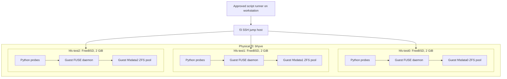

# Initial lab: operations and agent handoff

The infrastructure was booted and tested on **2026-10-25**, following explicit approval to start the guests, stop Rocky for RAM, and run the existing PoCs. See [preparation](FreeBSD-lab-preparation.md), [approval rules](Test-automation.md), and the future [integration matrix](Integration-tests.md).

## Two distinct test paths



Each native VM executes its **own** FUSE process and kernel module, using its **own** ZFS storage. f3 provides virtual hardware and outer disk storage. There is no host FUSE mount in this native data path. The guests can reach one another, but no replication or etcd service exists yet.

A separate phase runs `Rocky → virtio-9p → f3 host FUSE → host ZFS`, using the earlier transport PoC. It requires stopping the three lab guests before starting Rocky. This is a regression check for eventual workload access, not part of the native three-VM integration test suite.

## Inventory and access

| Guest | Address | Storage |
|---|---|---|
| hfs-test0 | 172.31.253.11 | hfsdata0/{data,journal,control} |
| hfs-test1 | 172.31.253.12 | hfsdata1/{data,journal,control} |
| hfs-test2 | 172.31.253.13 | hfsdata2/{data,journal,control} |

FreeBSD 15.1-RELEASE, two vCPUs, 2 GiB RAM, 20 GiB UFS OS disk and 16 GiB ZFS data disk per guest. Guest ARC limit: 256 MiB. The isolated `hfslab` bridge has host address 172.31.253.1, no uplink/NAT; guests have no default route. SSH uses Paul's public key and independently generated, pinned guest host keys:

```sh
ssh -o StrictHostKeyChecking=yes \
  -o UserKnownHostsFile=docs/lab/f3-known_hosts \
  -J paul@f3 root@172.31.253.11
```

Use `.12` or `.13` for the others. No private SSH keys are copied to f3 or the guests. Python 3.12.15 and its separately packaged SQLite module are installed in all guests. Their package inventories are in the result artifacts.

## Approved native run

Obtain approval for the run and any Rocky downtime first. From the repository root:

```sh
ssh f3 'doas -n vm list; swapinfo -h'
tools/lab/vms.sh --approved-action stop-rocky
tools/lab/vms.sh --approved-action start-lab
```

The lifecycle script waits for clean ACPI stops and never force-kills. Starting the lab rejects running Rocky/the other FreeBSD development VM, an insufficient physical-memory budget, active host swap use, or a changed guest RAM allocation. Still inspect other processes/VMs and memory pressure before approval: this small fixed-profile helper is not a general resource scheduler. Startup is asynchronous; wait for all three pinned SSH connections before running checks. No persistent autostart configuration is changed.

Build once on a Go build machine:

```sh
(cd tools/poc/fuse-passthrough && \
  GOOS=freebsd GOARCH=amd64 CGO_ENABLED=0 \
  go build -o /tmp/homelabfs-fuse-poc .)
```

The initial run used Go 1.26.8 and go-fuse v2.9.0. The package bundle is cached on f3 as `/var/tmp/hfs-lab-packages.tar`; copy it locally:

```sh
scp f3:/var/tmp/hfs-lab-packages.tar /tmp/hfs-lab-packages.tar
tools/lab/check-native-poc.sh --approved-run UNIQUE_RUN_ID \
  /tmp/homelabfs-fuse-poc /tmp/hfs-lab-packages.tar
```

The script does not start/stop VMs. It refuses an existing run ID, stages dependencies over SSH, checks peer connectivity and guest ZFS, then mounts FUSE inside each guest. It runs the existing eight functional checks and bounded I/O probes against direct guest ZFS and guest FUSE sequentially. Functional invocations have 60-second limits; I/O invocations have 120-second limits. Payloads are confined to fresh directories; successful runs remove payloads and unmount FUSE. Scripts, binaries, package staging and logs remain under `/var/tmp/hfs-poc-RUN_ID` for inspection. Results are copied to `docs/lab/results/RUN_ID` on the workstation.

The supplied flag acknowledges an already approved operator action; it is **not** an approval mechanism or authorization for unattended CI. The full plan-bound runner described in Test-automation remains future work. SSH transfer interruption may require manual inspection/cleanup; these helpers are not yet a durable, crash-resumable lifecycle system.

### Recreate the offline dependency bundle

On f3, with authorization to refresh test dependencies:

```sh
doas mkdir -p /var/tmp/hfs-lab-packages
doas pkg fetch -y -d -o /var/tmp/hfs-lab-packages python312 py312-sqlite3
doas pkg fetch -y -o /var/tmp/hfs-lab-packages pkg
doas tar -cf /var/tmp/hfs-lab-packages.tar -C /var/tmp/hfs-lab-packages/All .
doas chmod 644 /var/tmp/hfs-lab-packages.tar
```

The current archive contains `Hashed/*.pkg`; the runner discovers packages recursively. `pkg` must be upgraded in a separate invocation before the remaining packages, allowing the new process to migrate its local database. `pkg add` uses `ASSUME_ALWAYS_YES`, not `-y`. The cached bundle is a snapshot of the initial setup, not a permanent dependency update policy. A newly fetched bundle needs its versions/checksum recorded and validation again. Future distribution belongs in [pkgrepo](Packaging-and-rollout.md).

## Approved 9p regression phase

After native probes finish and remove their mounts:

```sh
tools/lab/vms.sh --approved-action stop-lab
tools/lab/vms.sh --approved-action start-rocky
```

Wait for Rocky SSH. Its normal stock kernel lacks 9p. Follow the [PoC runbook](PoC-runbook.md) to select the installed ELRepo `6.1.190-1.el9.elrepo.x86_64` kernel with `grub2-reboot` for one boot, then reboot cleanly. Discover the entry ID locally; retain the stock default. Use `ssh root@rocky` for administration: Paul's account does not have general sudo permission. The stock default observed during this run was `5.14.0-687.60.1.el9_8.x86_64`.

The existing Rocky bhyve config exports `homelabfs_poc=/var/tmp/homelabfs-9p-poc/share` at slot `0:7:0`. Do not add a duplicate device. Once `modinfo 9pnet_virtio` succeeds:

```sh
tools/lab/check-9p-poc.sh --approved-run UNIQUE_9P_RUN_ID \
  /tmp/homelabfs-fuse-poc
```

This creates a fresh host FUSE mount beneath the existing export and a fresh guest 9p mount using `cache=mmap`. It runs the same functional/I/O probes on raw 9p and 9p/FUSE, collects evidence, then normally unmounts both layers and removes empty backing/mount directories. No fstab or service entry is added. If a connection or cleanup fails, inspect guest and host mounts before deleting any directory. Do not recursively delete through a live mount.

To return to the lab arrangement:

```sh
tools/lab/vms.sh --approved-action stop-rocky
tools/lab/vms.sh --approved-action start-lab
```

## Initial results and setup fixes

The successful native run is [`20261025-initial-r4`](lab/results/20261025-initial-r4/): all **48 functional checks passed** (three guests × two paths × eight checks). All six bounded I/O invocations passed checksum/read-back verification for a 128 MiB sequential file, 256 random 4 KiB writes with per-write fsync, and four concurrent 16 MiB files. Each guest reached all three lab addresses. These are functional smoke checks, not a controlled performance benchmark.

Earlier setup attempts are retained under `20261025-initial`, `-r2`, and `-r3`. They exposed package layout/CLI issues and a mount-readiness check that expected exactly `fusefs`. FreeBSD reports this named mount as `fusefs.homelabf`; the check now accepts the named subtype. A transient `pkg` schema error after updating pkg in the same process was fixed by using separate invocations; subsequent package queries succeeded. Those attempts are not filesystem test passes. No guest OS rebuild was needed.

The native PoC still logs `Unimplemented opcode BMAP`, as in the earlier host experiment; the tested operations passed. No distributed journal, cross-node locks, ownership, failover, crash durability, or real application portfolio has been validated. These guests now provide the infrastructure on which that future implementation can be tested.

The separate [`20261025-9p`](lab/results/20261025-9p/) regression passed all **16 functional checks** and both bounded I/O invocations for raw 9p and 9p/FUSE. Rocky ran ELRepo 6.1.190 for that phase, with SELinux enforcing and the stock kernel retained as its normal boot default. The three native guests were stopped throughout the Rocky phase. This run did not repeat fio; throughput from the Python smoke probe is not comparable to the prior controlled job settings.

## Final state and next work

At completion, all three lab guests are running, Rocky and the unrelated `freebsd` development VM are stopped, and guest ZFS pools import successfully after a clean stop/start. Final checks confirmed ping and TCP port 22 connectivity from every guest to every lab address; see [final state evidence](lab/results/20261025-final/). The temporary FUSE and 9p mounts are removed; no PoC daemon is configured to auto-start. Start a new approved check to create a fresh run-owned mount. Guest OS disks retain Python, package caches, the PoC binaries/scripts, and run logs. Successful probes removed their data payloads.

`vm_list` still names only Rocky: a physical f3 restart will start Rocky and leave the lab guests stopped. Do not change that policy implicitly. Historical preparation manifests remain unchanged; inspect live state rather than treating them as current status.

The next implementation work is HomelabFS itself and its plan-bound integration harness. Reuse the existing guests for bounded approved PoCs; do not confuse those reusable preparation assets with the eventual disposable per-run clone lifecycle. Before failure injection or replication testing, implement fencing, journals, role management, and test-cluster identity/credentials. Future runs still require fresh approval.

## Replication copy

The lab now has an encrypted, periodic [replication copy on f2](Lab-replication.md), including recovery prerequisites and verification commands. This replaces the original preparation state where only local snapshots covered the lab.

## Native Stage 1 admission attempt, 2026-10-30

Paul approved run `20261029-n1`, exact canonical plan hash
`c22be74e288f900b15ebd8852c079f3d51e5e6f6abe2a558dc45053491a16f88`.
Pinned SSH found f3 already running, with Rocky PID 6449 running, all four
FreeBSD VMs stopped and no host swap use; no host power operation was needed.

The read-only admission step failed at 05:53:50 UTC because the pinned source
snapshot `zrepl_20261029_212328_000` had been pruned. The plan was still within
its validity period, but its source snapshot was unavailable. No lifecycle,
native setup or workload step ran, so none of the twelve native behavior calls
was executed. The snapshot/GUID/zero-written checks were preserved.

The runner subsequently attempted guest evidence collection despite admission
having failed before guest startup. Guest SSH timed out during banner exchange;
collection was conservatively recorded as ambiguous. A fresh pinned-host
inventory and local process check established that the guests remained stopped,
Rocky retained PID 6449, and no guest SSH child remained. Explicit reconciliation
recorded collection as failed. Cleanup skipped all inapplicable VM/resource
actions and closed the run with `complete=true`, `success=false` and exit 1.
The report's twelve potentially remaining resources are its conservative declared
inventory; run-owned setup was never invoked.

[Reports and logs](lab/results/20261029-n1/) preserve the failed admission,
collection error, reconciliation history and final state. Follow-up tasks `ax3`
and `bx3` cover collection admission gating and fresh offline source metadata.
A replacement plan needs fresh exact-plan approval; this attempt provides no
native filesystem acceptance result.

The separately approved replacement `20261030-n2` also stopped at read-only
admission. Its [reports and diagnostic](lab/results/20261030-n2/) establish a
transport parsing defect: OpenSSH diagnostic stderr was merged into the correct
Rocky kernel stdout. Task `cx3` separates those streams without relaxing version
or host-key checks. No VM or workload step ran. The `ax3` collection gate worked:
collection and inapplicable teardown were skipped, and the run closed as a
completed failure. Fresh host/source checks at 06:25:14 UTC retained Rocky PID
6449, all four stopped FreeBSD VMs, zero swap and unchanged R4 source GUIDs with
zero writes. Further actual native execution still needs its exact plan approval.

After Paul instructed continuation and allowed f3 startup, the
[n3 attempt](lab/results/20261030-n3/) found f3 unreachable. Cooling was enabled
and one f3-only Wake-on-LAN packet was sent. Pinned SSH subsequently showed a
new host boot with Rocky PID 6440 and all four FreeBSD VMs stopped. The approved
runner then rejected the old image snapshot's zero-written check before any
VM lifecycle or native workload step. The run closed as a completed failure
with collection and inapplicable teardown skipped. Follow-up `dx3` refreshes
the image evidence against the post-boot state; no identity check was relaxed.

The [n4 attempt](lab/results/20261030-n4/) passed fresh admission and cleanly
stopped Rocky. After asynchronous guest startup, readiness rejected the normal
`Bootloader` inventory state before native setup or workload execution. Normal
`vm stop` ended the guest bootloaders, and Rocky was started again. Its original
restoration readiness check lost SSH before establishing a completed host
inventory; the transport cause is unknown because its diagnostic stderr was
not retained. Tasks `ex3` and `fx3` track boot readiness and reconciliation.

Fresh pinned observations at 08:27 UTC established Rocky PID 17368 running,
all four FreeBSD VMs stopped, zero host swap, working Rocky root SSH with the
expected kernel, and no outstanding readiness commands. Explicit reconciliation
recorded the original restoration check as failed. The runner retained
`complete=false`, `success=false`: its single restoration attempt was exhausted.
No readiness or workload was replayed, and no pass was inferred from the later
observations. The original ambiguous report and final failed report are both
preserved. A replacement native run requires refreshed image evidence, the
readiness fix and fresh approval of its exact plan.

The separately approved [n5 attempt](lab/results/20261030-n5/) passed admission,
clean Rocky shutdown and all three guests' pinned SSH/kernel readiness. Setup
returned an uncertain exit before any saved guest preflight receipt, reservation
or workload. A fresh traced read-only preflight reproduced a mode-format bug:
`stat -f %Lp` emits `777` while the actual directory mode is correctly `1777`.
No guest permission change is needed. Positive inventories established no
run-owned guest resources or outstanding processes. Setup was reconciled failed;
cleanup quiescence was independently verified after the same guard rejected the
original cleanup command. The accepted cleanup reconciliation preserves that
command's original ambiguous history and permits normal shutdown/restoration.

All three native guests then stopped cleanly and Rocky started. Restoration
readiness hit a host TCP connection timeout before its initial SSH inventory
command; diagnostics now preserve the precise exit and stderr. Fresh pinned
observations at 09:22 UTC verified Rocky PID 31349 running with working root SSH,
all four FreeBSD VMs stopped and zero host swap. Original readiness remains
reconciled failed, and the report retains `complete=false`, `success=false`.
Tasks `ix3`, `jx3`, `kx3` and `lx3` address the mode guards, corresponding fault
fixtures, host connection wait and native diagnostic retention. No native
behavior call ran; another exact-plan approval is required after preparation.

The approved [n6 attempt](lab/results/20261030-n6/) passed admission, clean Rocky
shutdown, all three guests' readiness and setup. Its first root/direct fixture
failed during mounting because FreeBSD's `mount_fusefs` rejected the adapter's
Linux `nodev` option. No filesystem behavior case ran; task `ay3` fixes the
platform-specific options while retaining permission and device protections.
Collection, normal cleanup, guest shutdown and Rocky restoration/readiness all
passed in the original invocation. The final report is `complete=true`,
`success=false`, with no uncertain step or reconciliation. Rocky was restored
running and all four FreeBSD guests stopped; failed run resources remain for
inspection. Paul also confirmed standing approval for bounded non-production
tests and their planned graceful lab lifecycle. Critical or dangerous operations
and production changes remain outside that authorization.

The standing-authorized [n7 attempt](lab/results/20261030-n7/) mounted the new
candidate and ran its first root/direct fixture. Nine checks passed, including
permissions, sync, append, locking and normal unmount. The namespace case failed
at `ftruncate` with EOPNOTSUPP; the remaining eleven fixtures were not started.
Task `cy3` adds atomic native truncate/timestamp selection without changing the
existing journal format. The exact N7 request mask was not captured; kernel
source and local callback regressions explain the previously rejected forms.
All original collection, cleanup, guest shutdown and Rocky restoration/readiness
steps passed. The report retains `complete=true`, `success=false`; failed
resources and raw evidence remain. This does not complete the native matrix.

The standing-authorized [n8 attempt](lab/results/20261030-n8/) passed admission
and graceful lifecycle startup but stopped at native readiness: vm-bhyve
reported a local `Locked (f3.lan.buetow.org)` startup state before a bootloader
process was visible. No native setup or workload ran. Task `ey3` preserves
this as bounded not-ready while requiring all guests to reach Running before
SSH or test dispatch. All original guest shutdown and Rocky restoration
steps passed; the report is `complete=true`, `success=false`, with all four
FreeBSD VMs stopped and Rocky restored. Fresh image attestations are required
after the boot attempt; this run does not validate the truncate fix.

The standing-authorized [n9 attempt](lab/results/20261030-n9/) passed both
root/direct and root/buffered fixtures on hfs-test0, including truncate, mmap
and multiuser permission checks. Its unprivileged/direct append case timed out
waiting for a helper response; later lock failure reused the broken client.
Task `hy3` investigates the timeout. The remaining nine fixture calls did not run.
Collection then lost SSH during banner exchange and correctly blocked cleanup.
Completed host/guest/process inspections established no outstanding collection
action; explicit failed reconciliation preserved that failure and allowed normal
cleanup. All guest shutdown and Rocky restoration/readiness steps passed.
The final report is `complete=true`, `success=false`, with original ambiguous
reports retained. Task `iy3` makes native SSH configuration explicit without
claiming the connection failure's unknown cause was established.

The standing-authorized [n10 attempt](lab/results/20261030-n10/) again passed
both root fixtures on hfs-test0, then failed unprivileged/direct append at the
unchanged eight-second bound. Bounded helper diagnostics show continuing write
progress with completed write-wrapper medians around 0.56 seconds, versus
0.14–0.15 seconds for root. No underlying latency or deadlock cause is established.
Task `ky3` records that investigation; the remaining nine fixtures did not run.
Collection and every normal cleanup/shutdown/Rocky restoration step passed in
the original invocation. Final report: `complete=true`, `success=false`, with
Rocky PID 3774 running and all four FreeBSD guests stopped in a final pinned
13:25:23 UTC inventory. The native gate remains pending. Work paused on Paul's
explicit request after recording this attempt; no next run was started.

The standing-authorized [n11 admission](lab/results/20261030-n11/) stopped at
its first host SSH connection timeout, before any VM lifecycle or native test.
Fresh completed pinned inventories/process inspection confirmed Rocky PID 3774
running, all FreeBSD guests stopped and no outstanding admission command.
Explicit failed reconciliation preserved the original ambiguous reports;
cleanup skipped inapplicable actions and closed `complete=true`, `success=false`.
No host power/configuration change occurred. The connection-timeout cause is
unknown; native validation of the journal read-window change remains pending.

The standing-authorized [n12 attempt](lab/results/20261030-n12/) passed admission
and setup, then stopped at its first root/direct fixture's process-lock case:
a successful-acquisition `fcntl-try` returned EAGAIN after the interruption
check had passed. Task `qy3` records stage/holder diagnosis; the exact cause
is unestablished. Append passed, but the unprivileged fixture was not reached,
so `ky3` native validation remains pending. Collection and all normal cleanup,
shutdown and Rocky restoration/readiness steps passed. Final report is
`complete=true`, `success=false`; a pinned 15:02:05 UTC inventory confirmed
Rocky PID 24786 running and all FreeBSD guests stopped.

The standing-authorized [n13 attempt](lab/results/20261030-n13/) localized the
lock failure: after helper 1's completed Stop/Wait, helper 0's acquisition
failed and F_GETLK still reported helper 1's PID as the POSIX holder. Captured
append PIDs corroborate the identity. Task `sy3` corrects explicit owned-process
retirement using controlled regressions; no kernel callback cause or native fix
is claimed yet. The remaining eleven fixture calls did not run, so `ky3`
unprivileged append validation remains pending. Collection and all normal
cleanup/shutdown/Rocky restoration steps passed; final report is
`complete=true`, `success=false`. Final pinned inventory at 15:34:04 UTC showed
Rocky PID 37004 running and all four FreeBSD guests stopped.

The standing-authorized [n14 admission](lab/results/20261030-n14/) stopped at
an initial host SSH connection timeout, before lifecycle or workload. Fresh
completed pinned inventory/process checks confirmed Rocky PID 37004 running,
all four FreeBSD guests stopped and no outstanding prior action. Explicit failed
reconciliation preserved the original ambiguous report and closed
`complete=true`, `success=false`, with inapplicable cleanup/restoration skipped.
The timeout cause is unknown. No native acceptance was obtained; unchanged R15
metadata and c946ac5 binaries may be reused honestly with fresh admission.
