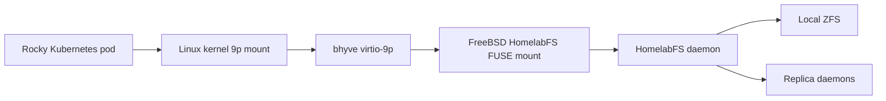
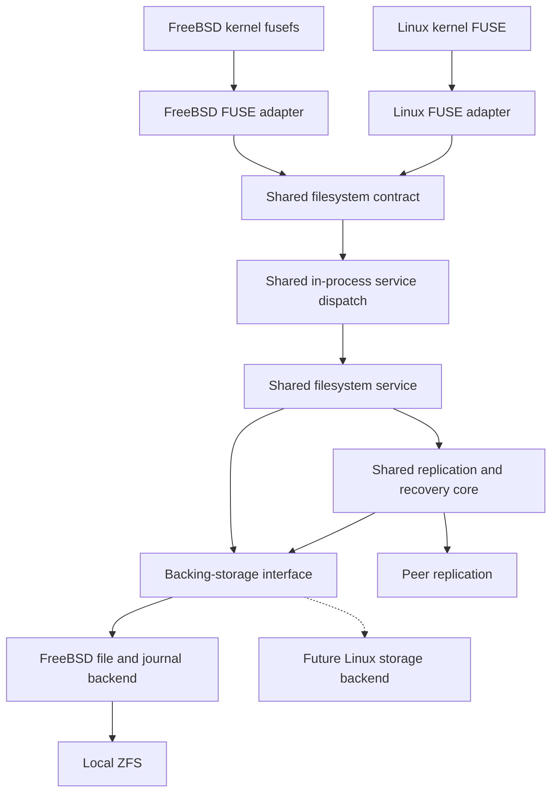

# HomelabFS platform interfaces

**Live prerequisite check:** the current f3 Rocky kernel lacks 9p support. See [f3 / Rocky PoC findings](PoC-f3-rocky.md). The selected guest path needs a kernel change before end-to-end testing.

[Architecture overview](Architecture.md)

Shared implementation boundaries, FreeBSD and Linux FUSE adapters, and the selected bhyve virtio-9p path.

## Shared core with FreeBSD and Linux interfaces

FreeBSD and Linux are both first-class frontend targets from the beginning. Use two platform-specific FUSE adapters implementing one shared filesystem contract, with shared callback glue where a common library permits it. Do not maintain two independent filesystems or duplicate the replication state machine.

Basic FUSE portability is feasible: FreeBSD documents portable FUSE APIs, and libfuse lists Linux support and best-effort BSD support. The harder work is matching observable semantics for caching, mmap, permissions, locks, sync, interrupted requests, and failure recovery. Treat basic mounting as moderate integration work and production-quality cross-platform behavior as substantial validation work. Go is the selected implementation language. FUSE library selection remains open pending a prototype on both platforms.

### Go implementation

Implement the shared filesystem service, journal/replication state machine, recovery controller, administration tools, and platform adapters in Go. The etcd Go ecosystem is a good integration fit; keep its client behind a coordination interface and outside the per-operation data path. This language choice does not imply embedding etcd into the HomelabFS daemon.

Evaluate [go-fuse](https://github.com/hanwen/go-fuse), whose documented releases include FreeBSD support, and [cgofuse](https://github.com/winfsp/cgofuse), which supports Linux and FreeBSD through libfuse. Choose only after verifying required operations, cancellation, cache controls, and recovery behavior on both actual kernels. If using cgo, confine native dependencies and memory ownership to the adapter boundary.

Use explicit Go interfaces for storage, coordination, replication transport, and filesystem requests. Isolate OS-specific syscalls with platform files/build constraints. Bound goroutines, queues, and retained write buffers; profile allocations and tail latency under replication load. Runtime or scheduler pauses must not violate serving authority or fencing. Keep journal and network encoding independent of Go's in-memory layouts.

### Component boundaries

| Component | Responsibility |
|---|---|
| Shared filesystem service | Stable object IDs, namespace operations, open handles, Unix metadata, application lock model, ordering, request results, and I/O gating during recovery |
| Shared replication core | Journal format, commit/replay state, epochs, replica configuration, catch-up, emergency mode, and admission rules |
| FreeBSD FUSE adapter | FreeBSD session/mount lifecycle, capability negotiation, native request/reply conversion, credentials, invalidation, and interruption handling |
| Linux FUSE adapter | Linux session/mount lifecycle and corresponding conversions, capabilities, invalidation, and interruption handling |
| Backing-storage interface | Local file operations, journal durability, apply/checkpoint operations, and OS-specific syscall behavior; ZFS remains the intended storage substrate |
| Service dispatch | Shared in-process filesystem calls behind either FUSE adapter; f3s guest access uses the existing virtio-9p stack above the FreeBSD mount |
| Platform integration | FreeBSD rc and Linux service management, mount permissions, logging, packaging, and Kubernetes CSI lifecycle |

The shared core must not depend on native FUSE structs, syscall flag values, native errno numbers, or OS-specific stat layouts. Define explicit internal types for object IDs, metadata, credentials, open flags, lock owners, durability requests, cancellation, and errors. Translate at the adapters. Journal and network formats must be versioned and platform-independent. Keep semantic decisions shared; platform differences belong at the boundaries.

Define an asynchronous request/completion interface so catch-up and replication do not exhaust a pool of blocked FUSE workers. Reply exactly once, preserve buffer/request lifetime, and distinguish cancellation of a wait from rollback of an already accepted mutation. Define inode lookup/forget lifetimes separately from open handles; stable IDs must survive rename and must not be confused with native ZFS inode numbers on another replica.

### Capability and semantic contract

Negotiate supported kernel/library capabilities and maintain a tested matrix per supported OS release. Define required behavior and explicit fallbacks for cache invalidation, attribute and entry caching, direct/writeback I/O, sync, mmap, advisory locks, permission enforcement, supplementary groups, and directory operations. Use the selected OS contract for platform-specific behavior while preserving the same distributed consistency guarantees.

Do not enable an optimization that lets the kernel acknowledge a write before HomelabFS's promised durability/replication boundary. Start with conservative verified cache settings; writable mmap and its writeback path need explicit tests. If required semantics cannot be provided by an adapter, reject the unsupported configuration or operation explicitly rather than silently weakening correctness. Match permissions using caller credentials, not the daemon's identity.

### f3s deployment consequence

The chosen f3s deployment runs the HomelabFS FUSE frontend and storage daemon on FreeBSD. Rocky guests access that mount through bhyve virtio-9p using their kernel 9p client. No custom guest-to-host HomelabFS RPC protocol or Linux FUSE daemon is needed for this deployment. Validate credential propagation, sync, and fencing across the sharing layer.

The Linux FUSE adapter remains a first-class portability target for other deployments. Share its filesystem contract and replication logic with FreeBSD; Linux storage-backend support requires its own validation. It is not a dependency of the f3s guest access path.

### bhyve directory sharing without guest FUSE

bhyve supports host directory sharing through virtio-9p. A Linux guest with the 9p filesystem and virtio transport drivers can mount that share using its kernel client, without running a Linux FUSE daemon. This is directory sharing through a protocol, not simultaneous direct mounting of the host ZFS pool inside the guest.

Selected f3s path:



Export the HomelabFS mount, not its raw ZFS backing directory: otherwise writes bypass journaling, ownership, and replication. This layered path is selected architecturally but has not yet been implemented or validated on the deployed hosts. Verify the installed bhyve release and Rocky kernel support for CONFIG_9P_FS, CONFIG_NET_9P, and CONFIG_NET_9P_VIRTIO; generic Linux support does not establish that the deployed Rocky kernel includes those drivers.

Prototype permissions/UID mapping, fsync propagation, locking, mmap, caching, file identity, and host-daemon restart behavior through the complete 9p-to-FUSE stack. Confirm loss of HomelabFS cannot expose the underlying mountpoint directory as an accidental writable fallback. Treat these checks as acceptance gates for the selected transport; any failure requires an explicit design revision rather than silently changing the guest access path. Do not assume virtio-9p is virtio-fs; they are different interfaces.

Early review identified two specific acceptance risks: the documented Linux 9p no-cache mode disables mmap, while its mmap mode includes writeback; and FreeBSD's main-branch lib9p backend reports successful locks without acquiring host locks. Guest-local locking may still work, so test the actual lock domain and deployed release rather than assuming either correctness or failure. The [test plan](Integration-tests.md#early-compatibility-gates) links the sources and defines the required checks. These findings do not change the selected transport automatically.

The two-platform FUSE architecture remains a portability requirement; f3s deploys the FreeBSD adapter and uses virtio-9p in its guests. Passing a ZFS zvol as a virtual disk is a separate block-storage design and does not expose the host's existing HomelabFS directory semantics.

References: [bhyve device and 9p backend documentation](https://github.com/freebsd/freebsd-src/blob/main/usr.sbin/bhyve/bhyve.8), [libvirt bhyve directory sharing](https://www.libvirt.org/drvbhyve.html#virtio-9p-filesystem), [Linux 9p client](https://docs.kernel.org/filesystems/9p.html).

### Validation and implementation order

Build the smallest real mount on both OSes before substantial replication implementation. Run the same behavioral suite on real FreeBSD and Linux kernels: permissions and multiple users; create/read/write/truncate; append and exclusive create; rename and hard links; unlink with open handles; locks; fsync and directory durability; mmap; cache invalidation; interrupt/unmount; daemon crashes and reconnect. Then run the shared replication fault scenarios through both adapters and the Linux-guest-to-FreeBSD path. Include SQLite/PostgreSQL recovery and actual f3s workloads before declaring compatibility.

A portable backend unit test is insufficient for kernel semantics. Maintain FreeBSD VM/host CI and Linux CI from the first working prototype. Keep performance benchmarks separate from correctness tests and measure the guest transport overhead.



References: [FreeBSD fusefs manual source](https://github.com/freebsd/freebsd-src/blob/main/share/man/man4/fusefs.4), [libfuse APIs and platform support](https://github.com/libfuse/libfuse), [Linux FUSE interface](https://docs.kernel.org/filesystems/fuse/fuse.html).

## Mounting on FreeBSD

Recommended first implementation: a userspace HomelabFS daemon using FreeBSD's existing fusefs kernel module. A custom HomelabFS kernel module is not required for this approach. FreeBSD supplies the kernel bridge; the daemon implements filesystem operations and coordinates local storage and replication.

The real FreeBSD setup commands are:

```sh
kldload fusefs
sysrc kld_list+=fusefs
mkdir -p /mnt/homelabfs
```

A future CLI might be `homelabfs mount --volume example /mnt/homelabfs`; this command does not exist yet. The chosen FUSE library would handle mounting through FreeBSD's FUSE interface and mount helper.

Keep backing files and the journal in a private ZFS location outside the exported mount, for example `/var/db/homelabfs`. Workloads must not bypass HomelabFS by modifying those files directly.

Evaluate a FUSE library for actual FreeBSD support before choosing a language or binding. Start with explicit caching behavior, then test read coherence, fsync, rename, open-file deletion, permissions, mmap, and application locking against the intended workloads. A custom kernel implementation can be reconsidered if measured performance or missing semantics justify it.

References: [FreeBSD filesystem handbook](https://docs.freebsd.org/en/books/handbook/filesystems/), [mount_fusefs manual](https://man.freebsd.org/cgi/man.cgi?query=mount_fusefs&sektion=8).
