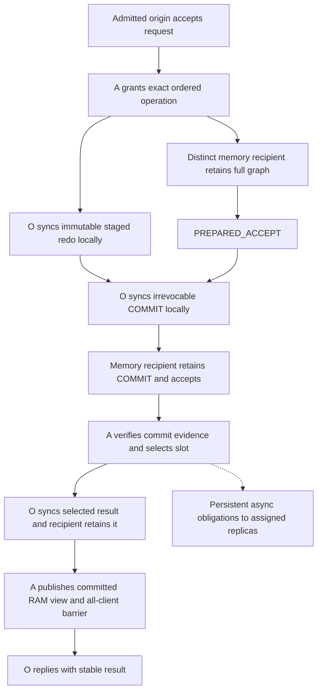

# HomelabFS replication and journals

[Architecture overview](Architecture.md)

The [normal protocol](spec/Replication-protocol.md) specifies coordinated writes
from every admitted node for every volume, independent of preferred ownership
and replica placement. This is the `cz3` design, **unimplemented and unproven**
pending `dz3`, successor formats and runtime/platform validation. Earlier v1
fixed-owner results remain scoped history. Emergency mode is separate.

## Normal write path

The preferred owner A sequences one outstanding mutating grant per dependency
closure. Origin O accepts the original request and durably journals its complete
new operation fragment locally. A checks the original credentials and fixes
conflicts, redo, append offsets, result and predecessor against its committed
logical cut. A grant is permission to propose that exact operation, not commitment.

For O != A the synchronous hosts are O durable + A retained RAM. O may be outside
the replica set. B is not an extra synchronous dependency on that path. For O=A,
a distinct configured B supplies retained memory; A cannot count itself twice.
Assigned replica delivery is asynchronous, persistent and retryable in both cases.

For a remote origin the memory recipient is A; for an owner-origin operation it
is B. The exact PREPARED_ACCEPT / COMMIT_ACCEPT / SELECTED / RESULT_ACCEPT /
PUBLISHED phases and durable source vectors are in the protocol. No single
network-round-trip claim is made. etcd installs infrequent authority transitions;
it is absent from the normal operation path.

A slot blocks successors until it resolves. Only the origin's mutually exclusive
durable COMMIT or DECLINE choice can close it in normal operation. Deadline or
lost reply means uncertainty, never permission to skip a hole or invent rollback.
Retries preserve the exact original claim/grant and return its stable result.

## Committed reads and multiple clients

All admitted nodes accept observations; initially nonowners route reads to A.
A serves a complete committed logical RAM projection over a verified baseline,
including data, namespace, permissions, metadata and object-home/handle lifetimes.
It can serve selected remote-origin state before its own disk persistence/apply.
Staged data and unselected candidates remain invisible.

Every frontend/cache domain must obey positive view barriers, including separate
FUSE mounts, guest 9p mounts, aliases, descriptors and mmap. A post-success read
cannot use stale cache pages. Concrete native/guest mechanisms remain unvalidated
publication gates; same-guest advisory locks do not provide storage coherence.
Normal support requires independent writable clients, with protocol gating where
needed. It does not impose an exclusive application client.

## Durability and accepted failure window

[Durability](spec/Durability.md) preserves ordinary daemon-write and fsync promises:
one origin durable journal plus the required distinct memory copy, with selected
result/publication conditions. No automatic local-only fallback or second durable
fsync copy is added. A RAM receipt is not a durable replica or proof that RAM has
survived an unobserved crash; delayed pre-crash ACKs are included in that window.
Losing the unique origin storage and all remaining required volatile copies may
lose acknowledged data. There is no finite RPO claim. An intact but temporarily
unavailable source instead gates recovery until it returns or equivalent complete
coverage is verified.

## Catch-up, retention and recovery

The selected history maps global slots to exact original journal fragments and
transitive dependencies. Durable coverage may span several origins, including
nodes outside placement. Retain each required source until a verified complete
durable replacement, replica baseline/suffix and protected pin release exist.
RAM receipt, backing apply, file age and an empty send queue never authorize GC.
Bound queues/overlay memory and reserve recovery capacity before issuing grants.

A new authority cannot be activated merely by collecting two placement replicas.
Close/fence all old granted origin and reader domains and collect complete sealed
reports from the old admitted-node set, or equivalent verified durable coverage
and complete grant-frontier proof. Missing unique fragments or uncertain grants
gate the closure. A dead node with fully proven replacement coverage is replaceable;
its permanent absence need not become a permanent outage. Restore the complete
selected graph durably on the prospective owner and distinct partner before crash
recovery activation. Exact recovery implementation remains `gz3`; old v1
[Takeover](spec/Takeover.md) is insufficient for outside-origin histories.

Periodic request-demand preferred-owner movement is a cooperative handoff, not
crash takeover or automatic replica redistribution. It transfers committed RAM,
source/pin graphs, claims, in-flight/unknown results and reader domains as one
closure. See [ownership reconsolidation](Cluster-and-ownership.md#periodic-ownership-reconsolidation).
Neither ownership movement nor immediate local replica placement is a prerequisite
for an admitted origin's write. Detailed policy/handoff is `kz3`.
