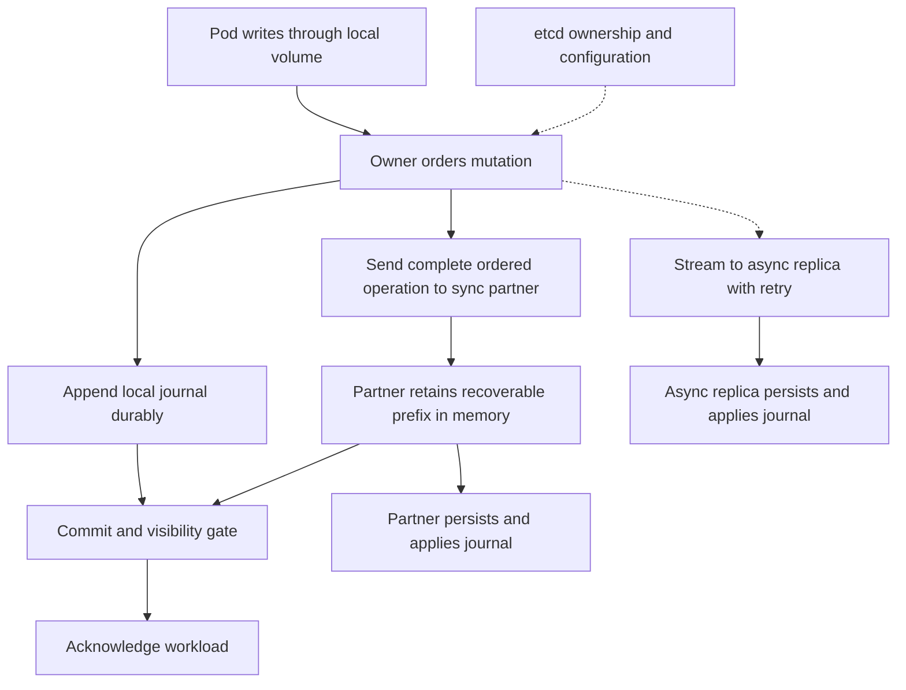

# HomelabFS replication and journals

[Architecture overview](Architecture.md)

Normal read/write behavior, replication guarantees, and continuity across ownership changes. The [normal replication protocol](spec/Replication-protocol.md) specifies fixed-owner handshake, messages, acceptance, commitment, visibility and retry semantics. It is an unimplemented design awaiting model/runtime validation. Emergency mode is described separately in [Emergency-mode.md](Emergency-mode.md).

## Write path and durability

Paul confirmed on 2026-10-28 that ordinary mutations delivered to the daemon and fsync require a durable local journal plus synchronous-partner memory receipt, together with the commit/visibility conditions. See the [durability and read-freshness contract](spec/Durability.md) for syscall promises and guest-buffering limitations. Two-durable-copy fsync is outside initial scope.

1. Verify exclusive ownership and readiness of the local replica.
2. Assign an operation identifier, ownership epoch, and sequence number within the owned unit.
3. In parallel, append and sync the local journal entry and send the operation to the synchronous partner.
4. The partner validates the ownership epoch and operation, retains the complete operation in memory, and acknowledges receipt.
5. Verify the exact COMMIT candidate's partner ACCEPT and local durable prefix, protect the stable result, and satisfy the protocol's visibility conditions before reply. Plain receipt of a MUTATION alone cannot establish commitment.
6. Persist and apply partner operations. Stream every operation to the asynchronous replica concurrently with the other work, without waiting for its ACK to complete the client request; retry and catch up from the retained journal.

This is a proposed logical flow; the precise records, gates and uncertain-outcome behavior are in the [protocol contract](spec/Replication-protocol.md#owner-and-partner-execution). Later result protection adds a covering receipt/wait; no single network round trip is promised. A complete journal entry must contain enough data and metadata to replay the operation. Reads must see committed changes even if application to backing files is deferred. Stage uncommitted mutations or gate access so passthrough cannot expose them early.

An in-memory acknowledgement is not a second durable copy. If the owner is lost and the partner restarts before persistence, acknowledged writes can be lost unless another surviving copy contains them. If the owner's disk is recoverable, those writes may instead be temporarily unavailable. This risk is accepted; silent conflicts between owners are not.

Define separately what an ordinary write, fsync, and synchronous open promise. Kernel caching must not accidentally weaken the promised acknowledgement boundary. A stronger fsync mode requiring two durable copies could be added later, but is not part of the agreed design.

## Normal write path for one volume

The commit/visibility gate verifies the [candidate, acceptance and result evidence](spec/Replication-protocol.md#streams-progress-and-decision-evidence): receipt alone is insufficient. Async delivery begins concurrently and retries from retained history.



The etcd edge represents previously established/background authority, not a per-write request.

## Local reads and transfer of ownership

Only the active owner normally serves reads and writes for a data set. Passive replicas ingest and apply the journal; they do not serve current-looking workload reads. This removes ordinary cross-node reader invalidation from the common path. Local reads use the owner's applied committed state and local synchronization. If a required committed operation is still being applied, reads wait.

On transfer, block workload access until the new owner has recovered and applied the authoritative prefix and acquired valid serving authority. Fence the previous owner for reads as well as writes, including kernel and guest caches. A disconnected old owner must not continue serving stale reads. Lease-based authority requires a specified clock/pause model and conservative expiry; alternatively use explicit fencing. A heartbeat timeout alone is insufficient.

The synchronous partner is up to date in recoverable journal state at every successful client acknowledgement. It may still lag in application to backing files. Failover therefore can be automatic, but includes failure detection, fencing, replay/application, and workload restart or reconnection. It does not promise zero interruption or transparent migration of open descriptors, process memory, or application locks from a failed host.

Ownership follows workload placement without permanent node pinning. Mount paths and data identity should remain stable after rescheduling. Shared volumes used simultaneously on multiple nodes are exceptions to this baseline: identify them during workload integration and choose suitable grouping, ownership granularity, or an explicit coherent sharing protocol. Do not silently serve stale reads to accommodate them.

## Continuous replication across failover and rejoin

Every node maintains its own replayable journal on local ZFS. Followers may first acknowledge in memory, but persist received entries afterward and retain enough history to become the source for lagging replicas. A promoted owner must preserve the inherited history and continue it under a new epoch, rather than starting an unrelated log. All mutations, including metadata and namespace changes, follow the same ordered stream.

Each receiver reports its received, durable, and applied positions separately. The sender uses durable progress to decide what can safely be discarded, retries missing entries, and detects gaps and duplicates. Synchronous receipt must cover a contiguous recoverable prefix, not just the newest message. Store commit/recovery evidence alongside operation data so takeover can resolve writes with uncertain replies.

Example for one data set:

```text
Healthy:       A = owner, B = synchronous replica, C = asynchronous replica
A fails:       B recovers and becomes owner; C catches up and becomes synchronous
A returns:     B remains owner, C remains synchronous, A catches up asynchronously
```

Alternative placement after A fails: C, previously asynchronous, can be selected as primary. C blocks I/O while recovering the missing prefix from B; after safe activation, C becomes primary and B its synchronous partner. Returning A then catches up from C. Promotion eligibility is not restricted to the former synchronous replica.

When A fails, B first persists and reconciles its inherited in-memory tail, establishes serving authority, and applies the recovered prefix. B supplies C with every missing operation from the old epoch. Before acknowledging new writes, B must establish C as a synchronous partner with the required recovered prefix. New writes then append durably to B's log and receive C's in-memory ACK in parallel. C still needs all earlier backlog; it cannot acknowledge a gap in its recoverable prefix. Waiting for C's backlog is part of failover time. Keeping C close to current is therefore an operational priority.

With only B and C online there is no third online replica. Do not leave C asynchronous while acknowledging new writes on B alone. Preserve the offline A catch-up obligation and resume delivery when A returns. A starts in RECOVERING, discovers B's authority, and receives the missing old/new-epoch history from B. Old local mutations from A's former ownership must not be replayed into the new history blindly. Reconcile or quarantine any divergent suffix; rebuild from a consistent snapshot if necessary. After catch-up A is an eligible replica, not automatically the owner. Planned failback would be a separate fenced transfer.

Async delivery uses a persistent obligation derived from the journal and receiver checkpoints, not a disposable memory queue. Retry after disconnects and daemon restarts; preserve progress across ownership changes. Bound memory queues, throttle background transfer without starving it, and report lag in bytes, operations, and time. Do not discard the last recoverable copy of a mutation merely because the async receiver is offline.

Finite storage requires a retention policy. Recommended: retain the needed journal suffix while practical; if a replica falls too far behind, install a snapshot at a known committed checkpoint and then replay every subsequent operation. This reproduces filesystem state but does not retain every historical operation. If literal replay of every historical update is required regardless of downtime, archive the log or stop writes before retention capacity is exhausted. Never silently skip a gap.

## Failover including promotion of the asynchronous replica

```mermaid
sequenceDiagram
    participant K as Kubernetes and volume integration
    participant A as A former primary
    participant B as B synchronous replica
    participant C as C asynchronous replica
    Note over A: Failure or isolation
    K->>C: Request volume for replacement pod
    Note over C: PROMOTING - workload I/O blocked
    Note over A,C: Establish new authority and fence old serving rights
    B->>B: Preserve and persist recoverable tail
    C->>B: Request authoritative history
    B->>C: Missing journal and recovery evidence
    C->>C: Persist and apply recovered prefix
    Note over B,C: Activate C primary and B synchronous partner
    C-->>K: Volume ready for workload I/O
    C->>B: New ordered mutations
    B-->>C: In-memory acknowledgement
    Note over A: Returns in RECOVERING
    C->>A: Replay missing history
    Note over A: Async replica after catch-up; no automatic failback
```

## Journal and recovery suggestions

- Track received, durable, and applied sequence positions separately on each replica.
- Make replay safe after duplicate delivery and crashes; identify operations by owned unit, epoch, and sequence number.
- Include checksums and record framing to detect torn or corrupted journal entries.
- Journal metadata operations too: create, rename, unlink, truncate, permissions, and directory changes.
- Define log retention and snapshot-based resynchronization for nodes that fall behind the retained history.
- Tie a resynchronization snapshot to a known journal position; send subsequent entries after the snapshot baseline.
- Bound in-memory queues and apply backpressure when a partner's disk cannot keep up.
- Keep backups independently of replication, which also propagates accidental deletion.

ZFS snapshots may help produce recovery baselines, but the relationship between snapshot contents, applied operations, and journal positions needs a consistent checkpoint procedure. HomelabFS's replication journal is an application-level design; the ZFS intent log is not automatically that journal.

## Journal housekeeping and concurrency

See [Journal-storage.md](Journal-storage.md) for the proposed sibling dataset layout and checkpoint-based deletion rules, and [Performance.md](Performance.md) for bounded parallel workloads, traffic separation, and measured connection-pool expansion. Neither concurrency nor cleanup may weaken the acknowledgement and recovery contract.
