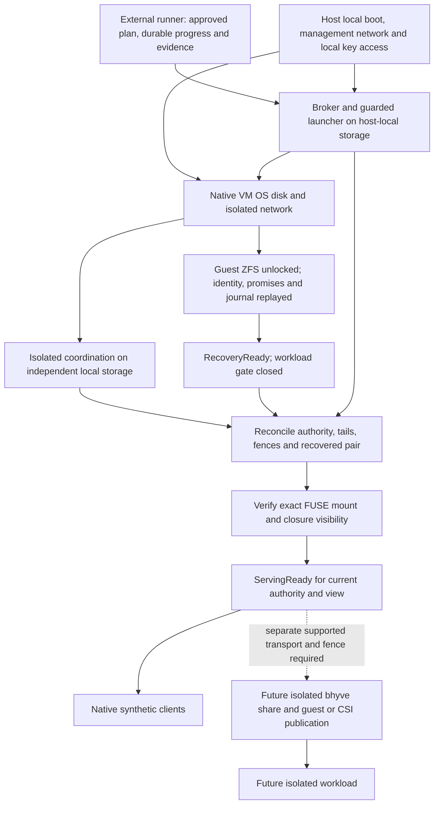

# Isolated cluster shutdown, maintenance and cold start

Status: design contract for `hv3`, 2026-10-28. Lifecycle implementation and
approved runtime evidence remain pending (`mv3`). This document authorizes no
installation, test run, VM lifecycle window, mount operation or physical power
action. It covers disposable lab/canary identities and synthetic data only.

[Takeover](Takeover.md) is authoritative for ownership, closure discovery,
promises, accepted-history selection, activation and the approved
`native-vm-stop-v1` policy. [Recovery](../Recovery.md) supplies the operating
contract; [Test automation](../Test-automation.md) supplies the plan-bound,
per-run approval requirement. Shutdown uses those contracts rather than a second
ownership protocol. Neither a power deadline nor successful shutdown allocates
serving authority.

## Supported boundary and prerequisites

The initial disruptive profile is the native three-guest lab: enrolled
`hfs-test0`–`hfs-test2`, each with guest-local FUSE, clients and ZFS. The precise
eligible subset, identities, closures and collateral roles belong to the approved
run manifest. The approved fence is **exactly**
[native-vm-stop-v1](Takeover.md#approved-isolated-fence-policy-native-vm-stop-v1):
bounded graceful ACPI stop of an enrolled, identity-verified launch, positive
execution exclusion and durable launch inhibition. Its 120-second stop window,
10-second RPC bound and at most three transport attempts within that same window
are unchanged. Timeout never enables force-kill, reset, physical-host power,
Rocky/production actions or a replacement owner without proof.

Guest SSH silence, a successful stop request or a `vm list` line is not exclusion
evidence. The independently reachable broker, guarded launch supervisor, exact
allowlist and signed attestations specified by Takeover must exist before this
profile can claim lifecycle fencing. Existing lab helpers do not implement them.
The policy decision is approved; installing them and exercising a VM window
still require separate approval. A profile cannot use Paul's administrator key
as a substitute for the restricted run-scoped broker principal.

The shared f3s canary and f3 host-FUSE/Rocky/9p probe remain non-disruptive
profiles. Their cached domains include paths outside a native guest; this policy
does not fence them. Disruptive guest-plus-host/9p, independent physical-host
loss and actual UPS/power-control exercises remain unsupported until separately
isolated targets, mechanisms, policy and evidence exist. Do not add 9p to the
native matrix or infer physical-host independence from three guests on f3.

The plan must inventory all clients, views, mmap/descriptor domains, affinity
closures, owner/partner/async roles and coordination roles affected by a whole-VM
stop. It must reject hidden external cache domains, unresolved closure membership
or disruption to anything outside enrollment. Inspect actual VM state and memory
admission in an approved window: the native guests use 6 GiB together and must
never run alongside the approximately 12 GiB Rocky VM on f3. Historical manifests
and prior approvals are not current admission or approval.

## Dependency order and independent roots

Arrows mean “must be available before”; the workload path starts only at the
final gate. Recovery traffic never depends on workload publication.

Host/guest boot disks, VM definitions, management networking, broker credentials,
attestation keys and launch guards must not reside on a serving HomelabFS volume.
The runner keeps its plan, approvals and intent/completion evidence outside the
disposable cluster; host guards also have an external evidence copy. Unlock
material and its recovery copy must be accessible without HomelabFS or the guest
being recovered. Never put secret material in the evidence bundle or repository.

Isolated etcd roots, its recovery artifacts and controller bootstrap policy use
independent local storage, not CSI volumes or a bhyve share exported by the very
HomelabFS instance they authorize. Native guest OS disks and local coordination
can boot before HomelabFS; their workload startup remains inhibited. A future
host/9p profile must likewise boot its controller/coordination without starting
a guest that first requires a serving share. If its only etcd lives inside such
a guest, it has a boot cycle and is unsupported until the roots are separated.
These are design prerequisites, not permission to relocate production etcd.

A broker on f3 survives a target guest failure, not f3 failure. Missing host
management or inaccessible guards block proof and successor activation. The
periodic f2 lab copy is not coordination or fence authority, a paired application
checkpoint, or a launchable replacement. Follow [Lab replication](../Lab-replication.md)
for separately approved recovery; never boot or modify the received sink.

## Observable gates and durable lifecycle state

Keep `Alive`, `RecoveryReady` and `ServingReady` separate as Takeover requires.
A mounted-but-gated FUSE session may exist for recovery; it grants no workload
reads, writes, readiness or CSI/bhyve publication. Internal replay/transfer uses
authenticated recovery paths behind gates. A directory's existence, a mounted
filesystem type, pod readiness or a live daemon alone never proves ServingReady.
Verify volume UUID, mount/session identity, configuration, closure visibility and
fresh view at publication; a missing/dead mount must expose no writable raw or
empty-directory fallback. A local gate cannot invalidate cached mmap reads:
positive execution exclusion is still required before conflicting publication.

The future runner durably records one lifecycle UUID and plan digest, target and
closure vectors, current authority, recovery attempts, precise phase/wait reason,
per-step intent/completion, client stop observations, drain-cut/dependency and
pin references, broker request/guard/attestation identities, local service-stop
progress and restoration inventory. Journal/etcd/broker evidence remains the
authority for protocol facts; a runner's “completed” bit cannot override it.

Write intent before each effect and verify completion afterward. Retry/query the
same identity after a lost reply; reconcile actual identities and durable state
after restart. An incomplete run has a nonzero/incomplete result, preserves
failed resources and accepted history, and enters `WAITING(reason)` or
`NEEDS_OPERATOR(reason)` using Takeover's distinction. No rollback deletes
promises, reopens a revoked launch, releases pins early or restores old authority.
Only an already approved restoration path may execute; expanded targets or
disruption require a new plan and approval.

## Quorum-preserving full-cluster shutdown

The global phases below precede the intended final-shutdown VM stops. This is
not parallel shutdown of arbitrarily chosen “non-master” nodes. Storage membership
remains the admitted three even when two are ready. Whole-VM stops also remove storage
and etcd roles; account for this before the first stop.

| Phase | Required action and verified completion |
|---|---|
| `PLANNED` | Validate the exact approval, immutable artifacts, enrolled targets and collateral roles; bound workload/backlog, queues, step/run deadlines, evidence/cleanup reserves and restoration. Confirm independent roots, usable coordination quorum and ready storage pair for every affected closure. An unavailable prerequisite blocks starting shutdown effects. |
| `QUIESCING` | With storage and coordination quorum still available, inhibit new workload starts/publications. Quiesce synthetic applications and flush their dirty buffers through existing sessions while normal ServingReady still holds; stop further mutations before closing daemon admission. Record which application flushes/terminations succeeded. A failed flush is not application-consistent success. Do not stop storage, coordination or the only holder of a needed tail. |
| `DRAINING` | Withdraw ServingReady, close workload access/new admissions for the entire discovered closure and bound in-flight work. Preserve accepted requests, unknown client replies, results and all transitive dependencies; finish or reconcile them by the normal/Takeover rules using internal paths. Keep the needed replicas and coordination alive. Pre-admission rejection is allowed; an accepted operation cannot become ABORT because shutdown, cancellation or a timer occurred. |
| `DRAIN_DURABLE` | Establish and sync a finite, exact drain cut for every closure member. Both the selected owner and ready synchronous partner durably hold the full recoverable graph: owner/reporter histories, accepted candidates and terms, protected outcomes, prepares/decisions, payload bases, request/session results, home/anchor/affinity dependencies, promises/configurations and retention pins. Reconcile unresolved slots through Takeover; unknown history blocks certification. Record per-stream/candidate evidence and both current-incarnation durable receipts, not scalar maxima or a memory ACK. Preserve the third replica's catch-up obligation. |
| `ACCESS_CLOSING` | Keep all workload gates closed; stop clients and normally unmount their run-owned access paths, collecting failures and descriptor/cache-domain inventory. Persist old serving-generation revocations and launch inhibition through the approved broker before its stop signal. Complete any coordination allocation/request authorization needed by the exact fence schema while quorum still exists. This prepares exclusion; cooperative unmount or service stop alone is not the whole-VM fence proof. |
| `STORAGE_STOPPING` | Only after the complete drain barrier, normally close the guest FUSE sessions and storage daemons, syncing shutdown/control progress. Preserve journals, pins and failed mounts. Every required sole volatile tail must already be safely persisted/transferred before its process or VM can stop. Failure to close a mount/service stops dependent teardown; do not force unmount or delete through a live mount. |
| `COORD_STOPPING` | After all access/storage phases are verified and all required allocations/guards/intents are durable, stop the isolated coordination services last. Persist the cluster shutdown inventory externally before intentionally losing its quorum. No remaining step may require a new ownership decision from that quorum. Coordination shutdown itself does not revoke an old cached view. |
| `GUEST_STOPPING` | Use only the approved broker's graceful stop of each enrolled launch. Collect positive execution exclusion and continuing guard evidence for every old serving domain. Honor the exact policy bounds; failure or unknown completion leaves the run incomplete and inhibits replacement publication. No escalation is supplied here. |
| `STOPPED` | All enrolled guest stops have verified proof, guards remain in force, and external evidence records the exact durable cuts, offline obligations and remaining resources. This says nothing about physical f3 being powered off. Preserve evidence and inhibition for cold start; do not automatically start Rocky or a replacement if guest exclusion is uncertain. |

If an owner I/O failure or uncertain slot requires Takeover to establish the
drain cut, pause clean-shutdown certification. Takeover may require its own
whole-VM fence before history selection and pair durability; that is a separate
recovery transition, not an early final-shutdown stop. Preserve all volatile
collateral dependencies before any voluntary stop, and execute recovery only if
its exact targets/actions are already covered by the approved plan. Otherwise
remain `WAITING` or `NEEDS_OPERATOR` for the appropriate prerequisite or plan.
After recovery, re-enter drain with the reconciled new authority and cut, keeping
workload startup inhibited. Never declare DRAIN_DURABLE prematurely or stop a
unique tail holder to break an apparent drain/fence dependency cycle. This branch
adds neither fence authority nor implicit approval for a disruptive window.

Before closing admissions, reserve the complete closure with Takeover's durable
predecessor-checked allocation/attempt mechanism and record shutdown intent plus
publication/workload-start inhibition. Serialize overlapping recovery or closure
joins; if discovery expands the set, reconcile the reservation and drain vector
before continuing. Controllers must retain this intent after restart: health
recovery cannot reopen a closure during deliberate shutdown. Releasing that
intent requires the approved reconciliation/restoration path and normal
activation predicates, never a healthy heartbeat or expired runner timeout.

The drain barrier deliberately strengthens ordinary owner-durable/partner-memory
ACKs for this lifecycle window; it does not redefine normal writes or fsync.
Applied progress, an async replica's newest sequence, ZFS pool export or an outer
VM snapshot is not an equivalent barrier. An offline third replica need not
finish catch-up to shut down safely if its retained obligations are durable and
the selected pair is complete; its return remains gated.

If independent service stops cannot be ordered inside a guest, record that
limitation and use a co-located stop only after **all** closure drain barriers,
access gates, coordination decisions and host guards are complete. Do not stop
one whole guest early merely to obtain a cache fence while another closure still
depends on its volatile tail. Failure injection that deliberately tests a lost
tail is a separately approved scenario, not a successful graceful shutdown.

A shutdown attempt may allocate a successor vector solely as required by the
Takeover fence request. It does not activate it. Cold boot changes incarnations;
reconcile/supersede any such vector with fresh authorization and higher promises
as Takeover requires, preserving its predecessor evidence. Never fabricate fields
or weaken broker validation to make a lifecycle-only request fit.

## Cold start and interrupted shutdown

Cold start is separately approved execution, with workload autostart disabled.
Read durable intent and verify broker guard continuity before permitting a fresh
recovery-only VM launch. Old memory images, resumes and stale snapshots remain
barred. The recovery-only launch has a new launch/daemon incarnation and grants
no old workload startup or serving role. Keep the broker's old-launch revocation
even when authorizing that new launch.

1. Admit actual host/guest resources and verify management/host identity,
   independent boot disks, local key access and current launch guards. Missing
   guard state or execution-observation continuity is an incident to reconcile,
   never permission to infer the old launch died.
2. Boot only enrolled recovery-only guests under the guarded launcher. Import and
   unlock their own ZFS; load admitted identity, emergency restrictions, highest
   durable promises and journal/control evidence before accepting replication.
   Restore isolated coordination quorum on independent local roots. In parallel,
   replicas may become RecoveryReady and exchange recovery data behind gates.
3. Reconcile the lifecycle attempt and the complete affinity closure with current
   etcd lineage, broker revocations and Takeover recovery state. Validate claimed
   drain cuts against actual durable copies. A clean-stop marker is evidence to
   check, not a shortcut around missing history. If coordination was restored
   from stale state, use Takeover's controlled recovery-generation procedure.
4. Execute Recovery's seven-step takeover contract: authorized promises and tail
   capture, full old-domain fence verification, semantic selection, durable
   prospective pair, gated apply and CONFIGURATION/activation. Reattest fence
   coverage for actual new successor incarnations. Wait for a delayed old owner
   when its disk is required; the first two boots are not automatically a valid
   pair. Never infer absence from a restarted partner's empty memory report.
5. Verify the actual FUSE mount/session and closure-wide visibility/cache
   barriers, then assert ServingReady for that exact authority/view. Only then
   publish the supported workload path and start synthetic clients. Continue
   catch-up of the third replica behind gates without automatic failback.

An interrupted shutdown always resumes from verified evidence, not its last
phase label. Before complete drain, keep surviving required sources alive and
reconcile accepted work. After complete drain but partial service/guest stops,
query exact broker operations and guard state; either finish the approved stop
or execute its approved recovery path with new incarnations. After coordination
quorum was intentionally stopped, restore it without workload publication before
making new decisions. A daemon/controller restart never resets the lifecycle or
enables client autostart. A dead FUSE session requires the validated platform
remount/restart procedure; reconnecting a pathname is not proof that old handles
now refer to the new mount.

## Rolling isolated maintenance

Only one enrolled test node may be unavailable at a time, and the plan must
include all its storage/coordination/client roles. Reassess quorum and complete
histories per closure before each step, not once for the entire maintenance run.
Do not shrink membership or use an extra admitted node as an implicit substitute.

For an async-only target with no serving/cache domain, retain its catch-up
obligations and verify the other two form the ready pair. Before voluntarily
stopping it, preserve any unique accepted history it holds for other closures.
For an owner or synchronous partner, quiesce the affected closure and perform
Takeover's full fenced transfer to a verified durable pair. Its initial policy
revokes the old serving generation even if the owner is retained; a transfer can
therefore require stopping/relaunching that owner's guest as well as the planned
maintenance target. Declare this collateral impact in the plan. If it would
remove the remaining required pair or etcd quorum, stop and use a fully quiesced
shutdown/recovery window instead; do not claim uninterrupted rolling service.

Before advancing, return the maintained node through a fresh recovery-only boot,
verify its identity/current promises/configuration and catch it up to the pinned
history as a passive eligible replica. Restore tested three-node storage and
coordination readiness before the next node. No automatic former-owner failback
or release of needed offline history is allowed. Failure mid-maintenance leaves
affected closures gated where necessary and preserves sources; never continue
to a second maintenance target because the first step timed out.

## Simulated UPS deadlines

An approved native scenario may inject a synthetic remaining-time value into the
runner, with a monotonic run deadline and fixed per-step/resource budgets. It
must not call apcupsd, f3sctl, Shelly, host poweroff or a physical UPS. There is no
claim that native co-located VMs validate real power failure or battery runtime.

Exercise both a budget that permits the complete drain/stop and a budget too
short to finish it. Reject new admissions early, prioritize persistence of
accepted work and export progress/evidence within reserved resources. Stop
starting dependent phases when their verified prerequisites or budget are absent.
The 120-second graceful fence ceiling does not grow, and a shorter scenario
deadline cannot certify a stop whose positive proof has not arrived. Query lost
replies using the same durable identity through the approved reconciliation path.

On deadline expiry report incomplete shutdown, remaining execution domains,
unpersisted/uncertain histories, guard coverage and remaining resources. Preserve
the only surviving volatile tail and keep its holder running until safe
persistence/transfer; a simulated “battery exhausted” event cannot kill it,
invent an ABORT, enter emergency mode or authorize forced poweroff. An actual
unexpected power loss follows Takeover's all-node reboot and explicit-loss rules,
including its accepted durability gap; it is never relabelled a clean drain.

## Failure and interruption table

| Observation | Safe action and evidence required before progress |
|---|---|
| Client fails to quiesce, flush or terminate | Close further admissions as appropriate, preserve accepted work and report failed application quiesce. Do not certify application consistency or stop its required tail holder. Cache exclusion still needs the approved whole-VM proof. |
| Only surviving accepted tail is volatile on the next stop target | Persist or safely transfer the complete history/dependencies before any voluntary process/VM stop. If unavailable, wait with that source alive; no deadline or cleanup override. |
| Partner sync fails, ENOSPC or incomplete drain graph | Gate affected closures, preserve buffers/copies/pins and report exact missing durability. Do not claim DRAIN_DURABLE from receipt/apply progress. |
| Drain needs Takeover, including its whole-VM fence | Pause clean-shutdown certification. Preserve all volatile collateral dependencies; perform only recovery already covered by the approved plan, or remain WAITING/NEEDS_OPERATOR. Re-enter drain under the reconciled authority/cut after recovery; never stop a unique tail holder to force progress. |
| Storage or etcd quorum lost during drain | Stop new admissions/completions when authority is uncertain, preserve sources and resume through Takeover when prerequisites return. No emergency downgrade or arbitrary two-node selection. |
| Controller/runner crashes or stop reply is lost | Reload external intent, query the same operation and reconcile journal/broker/etcd facts. Preserve inhibition and unknown outcomes; do not repeat a different target action or assume rollback. |
| Guest is paused/hung; graceful stop reaches its bound | Leave fence UNKNOWN/failed, launch guard retained and successor gated. No force-kill, reset, host shutdown or implicit expiry. |
| f3/broker management unavailable; host boot identity changed | No new proof from silence. Reconcile guard continuity and authoritative exact-launch exclusion before reattestation. Shared physical failure is not an independent fence. |
| Guard missing, wrong target, stale/replayed proof or unguarded launch route | Refuse enrollment/activation, preserve incident evidence and require policy-compliant repair. A newer time/epoch or historical VM name cannot repair identity/proof. |
| Some guests stopped before interruption | Preserve durable cuts and guards; reconcile remaining live sources and exact operations. Never start Rocky while any native guest stop is uncertain or restore old live memory to undo shutdown. |
| Shutdown ended before drain; all guests unexpectedly reboot | Reconcile full histories by semantic lineage and Takeover selection. Await needed owner disks; missing memory is not proof of absent acceptance. Report the durability gap if required bytes are lost. |
| Stale coordination snapshot, conflicting history or rollback | Keep publication closed, preserve all copies and use the separately authorized recovery-generation/loss workflow. Do not choose the highest sequence or erase promises. |
| Mount disappears or points to another session/volume | Withdraw ServingReady/publication, block raw/empty fallback and follow the validated remount/recovery path. Open descriptors/mmap need fence coverage before conflicting serving. |
| Simulated deadline or cleanup/restoration fails | Mark the run incomplete with separate timeout/cleanup/restoration results. Preserve live sources and failed resources; execute only the plan's approved safe reconciliation, never improvised escalation. |

## Implementation and evidence gates

`mv3` must integrate this contract with the plan-bound runner and daemon/service
APIs after the actual takeover/fence implementation (`lv3`) exists. Keep lifecycle
orchestration, platform fence observation and protocol authority separate: the
runner cannot mint a storage receipt, and a service readiness signal cannot
stand in for a broker attestation. No production f3sctl, UPS, NFS, stunnel, CARP,
mount-monitor, PV, consumer or snapshot-ownership changes belong to this work.
The existing parallel non-master shutdown is background for a separate future
project, not a dependency or implementation template here.

Future approved cases must cover clean full drain/cold start, every interrupted
intent/effect/completion boundary, lost replies, partial guest stops, broker/
controller restarts, all cold-boot permutations and delayed required owner,
maintenance of each role, and both simulated-deadline outcomes. Include active
descriptors/mmap, accepted/uncertain ordinary and transaction operations, partial
closure joins, sync failure/space pressure, missing keys, stale mounts, unavailable
coordination/management, hung ACPI and stale/missing guard negatives. Repeat with
each native guest in each applicable role using bounded synthetic backlogs.

Collect exact approved-plan/artifact digests, initial/final identity and resource
inventory, phase timings and wait reasons, per-closure drain graphs/receipts and
pins, promises/selection/activation references, broker signed proof/guard
continuity, mount/session and ServingReady transitions, client integrity/results,
timeout/assertion/infrastructure/cleanup/restoration outcomes and remaining
resources outside the guests. Compare against an independent acknowledged-work
oracle; no acknowledged surviving outcome may disappear or be applied twice, and
no workload may start before its full activation vector. Report unavailable as
the expected safety result for a failed fence, while distinguishing it from a
successful availability exercise.

Native cases compose with Recovery and Takeover's R/F scenario families; future
isolated deployment cases compose with K01–K05 without entering the native 9p-free
matrix. Native evidence cannot certify physical-host power loss, actual UPS
behavior or Rocky/9p/CSI fencing. This specification and its local documentation
checks are not runtime evidence; unsupported and unrun cases remain explicit.
